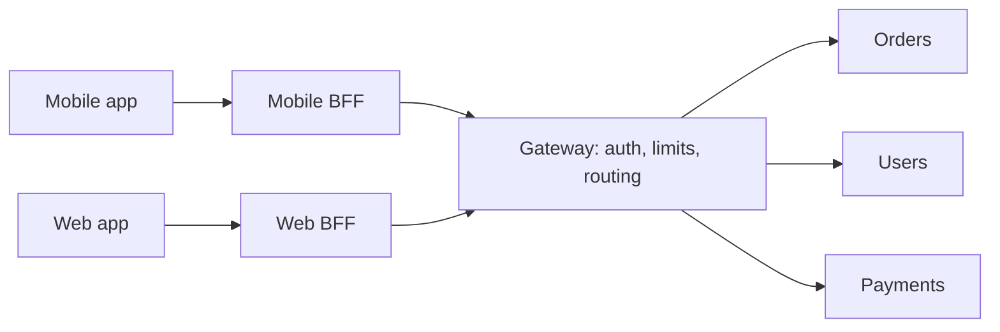

One front door for many services: authentication, rate limits,
routing and response shaping in a single place, at the cost of a hop and a coupling.

# API gateway

## What it is

A reverse proxy that fronts a set of services and owns the concerns that are identical
across all of them: authentication, authorisation, rate limiting, request validation,
routing, versioning, response aggregation, and telemetry.

It is not a load balancer with a different name. A load balancer spreads load; a gateway
understands the API.

## What belongs in it

| Concern | Good fit | Notes |
| --- | --- | --- |
| Authentication / token validation | Yes | Cache the verification; do not call an auth service per request |
| Rate limiting and quotas | Yes | Per key, per tenant |
| Routing and versioning | Yes | `/v1/orders` → order service |
| Request/response transformation | Sometimes | Beware of becoming a translation layer nobody understands |
| Aggregation (BFF) | Sometimes | Great for mobile; a new bottleneck if it holds business logic |
| Business logic | No | This is how a gateway becomes a distributed monolith |

## The backend-for-frontend variant

Rather than one gateway for everyone, give each client its own thin BFF: a mobile BFF that
returns small, aggregated payloads, and a web BFF that returns page-shaped data. The win is
that mobile clients stop over-fetching; the cost is more deployables and a temptation to
duplicate logic.

## When to reach for it

- More than three or four services are exposed to clients.
- The same auth and rate-limit code is being copy-pasted into services.
- Different clients need genuinely different response shapes.

## Trade-offs

1. **An extra network hop on every request** — 0.5–1 ms in-cluster, but it is on the p99 too.
2. **A shared deploy surface.** A bad gateway config takes down every service at once. Config
   changes need the same review as code.
3. **Coupling.** Every new endpoint must be registered and routed; teams wait on the gateway
   owner. Self-service routing configuration mitigates this.
4. **It can hide a bad service design.** If the gateway is stitching five calls together for
   every request, the services are wrong.

## Failure modes

- **Gateway as bottleneck** — all traffic through one tier with no horizontal scale plan.
- **Retry amplification** — gateway retries plus client retries plus service retries means
  nine attempts per user action.
- **Auth cache staleness** — a revoked token still accepted for the cache TTL. Keep that TTL
  shorter than your revocation promise.
- **Silent 429 storms** — limits applied globally rather than per tenant, so one abuser
  locks out everyone.

## Interview soundbite

> "I'd put a gateway in front for token validation, per-tenant rate limits and routing, and
> keep business logic out of it. The auth check is cached for 30 seconds, which is shorter
> than our token revocation window."

## Where to go next

- [Load balancer](load-balancer.md) and [rate limiter](rate-limiter.md).
- [Observability](observability.md) — the gateway is the best place to start tracing.
