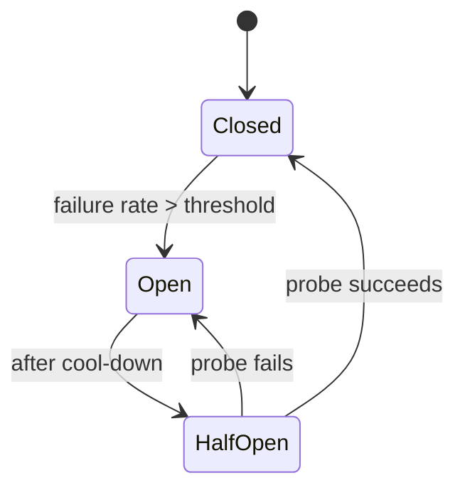

Stops calling a dependency that is failing, so that its failure does not
become yours. Fails fast, then probes carefully to recover.

# Circuit breaker

## What it is

A state machine wrapping a call to a dependency.

- **Closed** — calls pass through. Failures are counted.
- **Open** — calls fail immediately (or return a fallback) without touching the dependency.
- **Half-open** — a limited number of probe requests are allowed; success closes the circuit,
  failure reopens it.

## Why it works

A failing dependency has two costs: the error, and the *time* you spend waiting for it. With
a 30-second timeout and 200 threads, a dead dependency exhausts your pool in seconds and you
are down too. The breaker converts an unbounded wait into an instant decision.

## Configuration that matters

| Parameter | Meaning | Sensible starting point |
| --- | --- | --- |
| Failure threshold | Failure rate that opens the circuit | 50% over a rolling 10-second window |
| Minimum volume | Do not open on 1 failure out of 2 | At least 20 requests in the window |
| Cool-down | Time in open state before probing | 5–30 seconds, with jitter |
| Probe count | Requests allowed in half-open | 1–5 |
| Counted failures | What counts as failure | Timeouts, 5xx, connection errors — not 4xx |

## The fallback is the hard part

A breaker without a fallback just moves the error. Decide what the user sees:

- **Cached response** — last known recommendations.
- **Default** — empty recommendations, so the page still renders.
- **Degraded feature** — hide the widget, keep the page.
- **Queue the write** — accept it and process later.
- **Honest error** — for payment authorisation, there is no good fallback; fail clearly.

## Trade-offs

1. **False opens.** A brief blip can trip the circuit and cut off a healthy dependency. Tune
   the window, and require a minimum volume.
2. **Recovery is delicate.** Half-open with too many probes can re-kill a recovering service.
   Probe one request, then ramp.
3. **State is per instance.** Ten instances each need their own breaker, and they will open
   at slightly different times. That is acceptable; centralised breaker state usually is not
   worth the latency.
4. **It hides problems.** A breaker that is open for a week means a feature has been dead for
   a week. Alert on open state, not just on errors.

## Where breakers belong

Around **every** synchronous call to another service or a third party, at the point of the
call, in addition to timeouts. Timeouts bound one request; a breaker bounds a whole
dependency. Bulkheads (separate pools per dependency) complete the set.

## Failure modes

- **Breaker without timeout** — the open state helps, but the closed state still hangs.
- **Counting client errors** — a burst of 400s opens the circuit for a healthy service.
- **No jitter on cool-down** — every instance probes simultaneously and re-trips the
  dependency.
- **Silent fallbacks** — users see stale data for days and nobody notices.

## Interview soundbite

> "Per-dependency breaker with a 10-second rolling window and a 50% failure threshold, a
> cached fallback for recommendations, and a single half-open probe with jitter. I'd alert if
> it stays open for more than five minutes, because that means a feature is silently dead."

## Where to go next

- [Circuit breaker implementation](../code/circuit-breaker.md).
- [Retry and backoff](retry.md) — the partner pattern.
- [One service failing → breaker](../patterns/one-service-failing-breaker.md).
