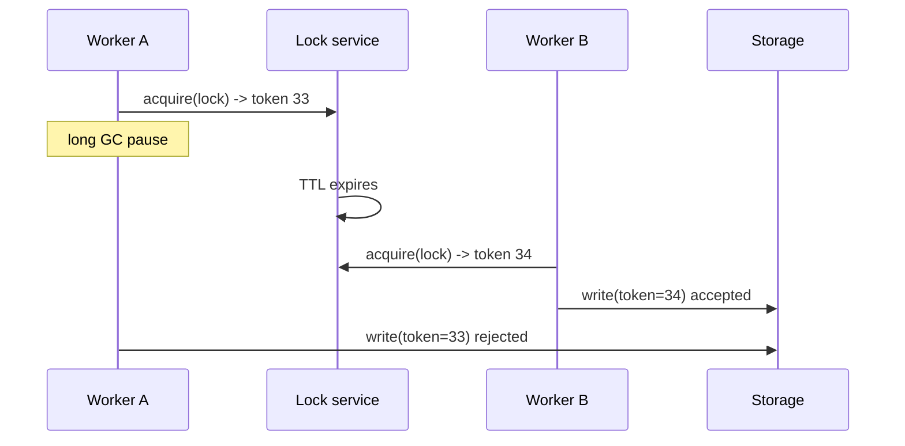

Ensures one worker does a job at a time across machines. Necessary
sometimes, overused often, and easy to get subtly wrong.

# Distributed locks

## What it is

A mutual-exclusion primitive spanning processes: acquire a named lock, do the work, release
it. Implemented over Redis, ZooKeeper, etcd, or a database row.

## Do you actually need one?

Work through this list before adding a lock:

1. **Can the work be idempotent instead?** Then two workers doing it is harmless, and you
   need no lock at all. This is the best answer and it is available more often than people
   think.
2. **Can you use a single-writer partition?** A queue partitioned by key gives you
   single-consumer ordering for free.
3. **Can the database enforce it?** A unique constraint or `SELECT ... FOR UPDATE` is far more
   reliable than a distributed lock.

Locks are for genuinely exclusive resources: a cron job that must run once, a migration, a
leader election, a resource that cannot tolerate concurrent mutation.

## The leases-and-fencing problem

A lock with a TTL can expire while the holder is still working — for example, a long garbage
collection pause. Then:

1. Worker A acquires the lock (TTL 30 s).
2. A pauses for 40 s (GC, network partition, VM freeze).
3. The lock expires; worker B acquires it and starts working.
4. A wakes up believing it still holds the lock, and writes.

Both are now writing. The standard fix is a **fencing token**: the lock service issues a
monotonically increasing number on each acquisition, and the storage layer rejects writes
carrying a token lower than the highest it has seen. Without fencing, a TTL lock is a
suggestion.

## Implementations, briefly

| Backend | Acquire | Strengths | Weaknesses |
| --- | --- | --- | --- |
| Redis (`SET NX PX`) | Atomic set with expiry | Fast, simple | Expiry races without fencing; single-node failover can lose the lock |
| Redis Redlock | Majority of N nodes | Tolerates node loss | Still relies on timing assumptions; contested |
| ZooKeeper / etcd | Ephemeral sequential nodes / lease | Strong, has fencing semantics, watch-based | Another cluster to operate |
| Database row | `UPDATE ... WHERE locked = false` | No new infrastructure | Lock table contention, and lock rows outlive crashes |

## Trade-offs

1. **Availability versus safety.** A lock service that is down blocks all work. A lock service
   that is partitioned may grant two locks. Choose which failure you prefer, explicitly.
2. **Latency.** Every acquire is a round trip; every short critical section becomes 2–3 ms
   longer.
3. **Operational complexity.** A lock cluster is a new dependency with its own failure modes.
4. **Debugging.** Deadlocks and stuck locks are the least reproducible class of production
   bug.

## Rules that keep it safe

- Always set a TTL. A lock without expiry becomes a permanent outage after one crash.
- Always use fencing tokens for anything that writes.
- Keep the critical section short; long sections are where expiry bites.
- Prefer leader election with leases over per-job locks for recurring work.
- Log every acquisition with a correlation ID, so a stuck lock can be traced to its holder.

## Interview soundbite

> "I'd avoid the lock: the job is idempotent, so two workers doing it is harmless. Where I do
> need exclusivity — the nightly billing run — I'd use a lease in etcd with a fencing token,
> so a paused worker cannot write after its lease expires."

## Where to go next

- [Sagas and workflows](sagas.md) — coordination without locks.
- [Idempotency](idempotency.md) — usually the better answer.
