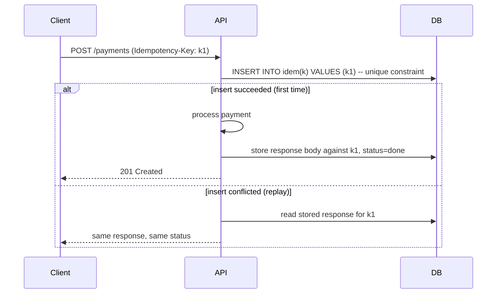

Makes a repeated operation safe. The primitive that lets you retry,
redeliver and double-click without duplicating the effect.

# Idempotency

## What it is

An operation is idempotent if performing it twice has the same effect as performing it once.
`SET x = 5` is idempotent; `x = x + 1` is not. Most real operations — charge a card, send an
email, create an order — are not naturally idempotent, so you add a key.

## The pattern

The critical property: **the key insert and the business write must be atomic** — one
transaction, or one unique constraint doing the work. A read-then-write check is a race and
will fail exactly when it matters, under concurrency.

## Practical details that get missed

| Detail | Why it matters |
| --- | --- |
| Key scope | Per user *and* endpoint; a global key space invites collisions |
| Key lifetime | TTL of hours to days — long enough to cover retries, short enough not to grow forever |
| In-flight handling | A concurrent duplicate should get `409 Conflict` or wait, not double-process |
| Storing the response | Replays must return the *original* body and status, not a re-computed one |
| Failure case | If processing failed, delete the key so a genuine retry can succeed |
| Payload mismatch | Same key with a different body should be rejected (`422`), not silently accepted |

## Where you need them

- Payment and refund APIs. Non-negotiable, and often a regulatory expectation.
- Order creation from a client that retries on timeout.
- Queue consumers (dedupe on message ID).
- Webhook receivers — providers retry, and they will send duplicates.
- Anything triggered by a double-click on a slow network.

## Idempotency without a key store

Sometimes you can make the operation naturally idempotent:

- **Conditional writes** — `UPDATE ... WHERE version = 7`. A replay fails harmlessly.
- **Deterministic IDs** — derive the record ID from the request (`hash(user, cart, minute)`),
  so a duplicate insert violates the primary key.
- **Upsert** — `INSERT ... ON CONFLICT DO NOTHING` when the last write wins anyway.
- **State machine guards** — "ship only if status = paid", so a duplicate ship event is
  ignored.

These are cheaper than a key store and worth reaching for first.

## Trade-offs

1. **A store to run, index and expire.** It is on the write path of your most important
   endpoint, so it must be as reliable as the data it protects.
2. **Atomicity is subtle.** If the key store and the business database are different systems,
   you are back to a distributed transaction. Put them in the same database, or accept a
   narrow window and reconcile.
3. **Retention is a policy question.** Too short and a late retry duplicates; too long and the
   table grows without bound.
4. **It does not deduplicate different requests.** Two genuine orders with identical contents
   are two orders; only the client knows the difference, which is why the key comes from the
   client.

## Failure modes

- **Read-then-write race** — two concurrent requests both see "no key" and both process.
- **Key generated server-side per request** — always unique, therefore useless.
- **Storing only the key, not the response** — the replay returns a different body.
- **Key deleted on success** — the next retry re-processes.

## Interview soundbite

> "The client sends an `Idempotency-Key`. I insert it into a unique-constrained table in the
> same transaction as the payment record, so the first request wins and any replay hits the
> constraint and returns the stored response. Keys expire after 24 hours."

## Where to go next

- [Idempotency store implementation](../code/idempotency.md).
- [Duplicate requests → idempotency](../patterns/duplicate-requests-idempotency.md).
- [Delivery semantics](../fundamentals/delivery-semantics.md).
