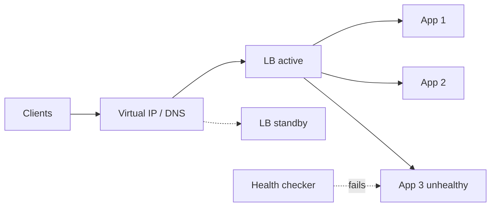

Spreads requests across identical instances and removes unhealthy ones
from rotation. The prerequisite is statelessness; the cost is one more thing that can
fail.

# Load balancer

## What it is

A component that accepts connections and forwards them to one of several backends. It
health-checks backends and stops sending traffic to ones that fail.

## How it works

| Layer | Sees | Can do | Cannot do |
| --- | --- | --- | --- |
| **L4 (TCP)** | IPs, ports | Fast forwarding, huge connection counts | Route by URL, terminate TLS with inspection, add headers |
| **L7 (HTTP)** | URLs, headers, cookies | Path routing, TLS termination, retries, sticky sessions, auth | — |

Algorithms, and when each is right:

- **Round robin** — uniform requests. The default.
- **Least connections** — variable request durations; avoids piling onto a slow backend.
- **Least response time** — latency-sensitive; needs live measurement.
- **Consistent hashing** — when a cache sits behind the balancer and you want key affinity.
- **Random with two choices** — surprisingly good, and avoids herd behaviour.

Health checks come in two flavours: **liveness** (is the process alive) and **readiness**
(should it receive traffic right now). Conflating them causes the classic outage where a
starting instance receives traffic before its connection pool is warm, or a struggling one
is killed for being slow rather than broken.

## When to reach for it

- More than one instance of anything serves traffic.
- You want zero-downtime deploys (drain, replace, resume).
- You need to terminate TLS once rather than in every service.

## Trade-offs

1. **It is a single point of failure unless it is itself redundant.** Active-passive or
   active-active pairs, plus DNS or anycast in front.
2. **Sticky sessions are a trap.** They make scaling uneven, they break on deploy, and they
   hide state that should be shared. Use them only for legacy protocols that cannot carry a
   token.
3. **The balancer sees everything.** If it does heavy L7 work per request, it becomes the
   bottleneck and the thing whose outage takes down all services at once.

## Failure modes

- **Health check too shallow** — the process answers `/health` but its database pool is
  dead. Check a dependency, cheaply.
- **Health check too deep** — one slow dependency marks every instance unhealthy and the
  balancer removes the entire fleet. This is how a small database blip becomes a full
  outage.
- **No connection draining** — deploys cut live requests, which look like random 502s.
- **Asymmetric load** — long-lived connections (WebSockets) defeat round robin; you need
  least-connections plus periodic rebalancing.

## Interview soundbite

> "Stateless app servers behind an L7 balancer, least-connections, with readiness checks
> that verify the database pool — and connection draining on deploy so a rollout does not
> drop in-flight requests."

## Where to go next

- [API gateway](api-gateway.md) — the layer above.
- [Service discovery](service-discovery.md) — how the balancer finds backends.
