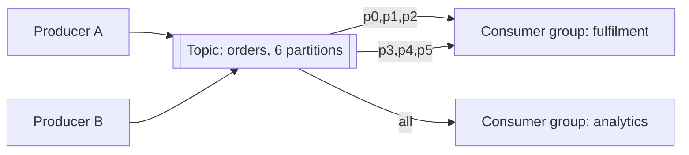

A durable buffer between a producer and a consumer. It decouples
arrival rate from processing rate, which is the cheapest way to survive a spike.

# Message queue

## What it is

A log or queue that holds messages until a consumer processes them. Producers write and
return; consumers read at their own pace.

Two shapes, and the difference matters:

| | Queue (SQS, RabbitMQ) | Log (Kafka, Pulsar, Kinesis) |
| --- | --- | --- |
| Consumption | Competing consumers; message deleted on ack | Consumers track offsets; message retained |
| Replay | No (or limited) | Yes — rewind and reprocess |
| Ordering | Best-effort, or FIFO queues with limits | Per-partition ordering |
| Fan-out | One consumer per message (unless SNS-style topics) | Many independent consumer groups |
| Throughput | High | Very high, sequential I/O |

## How it works

- **Partitions** — the unit of parallelism and ordering. A topic with 12 partitions can feed
  at most 12 consumers in a group.
- **Consumer groups** — each group sees all messages; within a group, partitions are split
  among members.
- **Offsets / acks** — the consumer records progress; on crash it resumes from the last
  committed offset, which is why redelivery happens.
- **Retention** — time or size based. Retention is what enables replay and reprocessing
  after a bug.
- **Dead-letter queue** — where poison messages go after N failures.

## When to reach for it

- The producer must respond faster than the work takes.
- Traffic is bursty and the downstream is not.
- Work must survive a crash of the worker.
- Multiple independent consumers need the same events.
- You need replay — reprocessing after a bug fix, or bootstrapping a new service.

## Trade-offs

1. **Completion becomes asynchronous.** The UI must show pending states and the system must
   reconcile. There is no "done" in the response.
2. **At-least-once delivery** means duplicates. Idempotent consumers are mandatory.
3. **Ordering is per key, not global.** Global ordering costs you a single partition and
   therefore a single consumer.
4. **A queue hides backpressure.** A growing queue looks healthy until it is a two-hour
   delay. Alert on message age.
5. **More moving parts** — another cluster to run, monitor, and upgrade, or another managed
   service to pay for.

## Failure modes

- **Poison message** blocking a partition → retry limit plus DLQ.
- **Consumer lag** growing silently → alert on oldest message age, autoscale on lag.
- **Rebalance storms** — consumers joining and leaving repeatedly stop the world; tune
  session timeouts.
- **Unbounded retention** filling disks → retention policy and monitoring.
- **Exactly-once believed** — see [delivery semantics](../fundamentals/delivery-semantics.md).

## Interview soundbite

> "Order events go to a topic partitioned by `order_id`, so each order's events stay ordered.
> Fulfilment consumes with an idempotent handler keyed on the event ID, and anything failing
> three times goes to a DLQ. I alert on the age of the oldest unprocessed message."

## Where to go next

- [Delivery semantics](../fundamentals/delivery-semantics.md).
- [Write spikes → queue](../patterns/write-spikes-queue.md).
- [Batch and stream processing](batch-and-stream.md).
