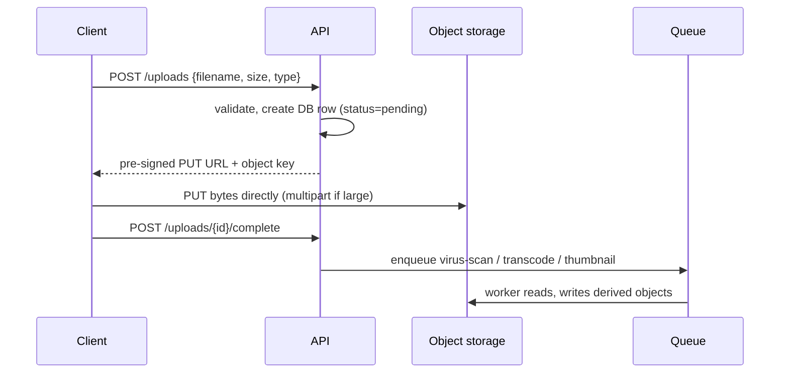

Cheap, durable storage for whole files addressed by key. The right home
for anything larger than a few kilobytes, and the wrong home for anything you need to
query.

# Object storage

## What it is

A key-value store for immutable blobs — S3, GCS, Azure Blob, MinIO. Objects are written
whole, addressed by key, and retrieved whole or by byte range. There is no partial update
and no directory hierarchy (prefixes are a naming convention).

Durability is achieved by replicating or erasure-coding objects across devices and zones,
which is why providers can quote eleven nines.

## The three things it is excellent at

1. **Storing bytes cheaply at any scale.** Far cheaper per GB than block storage or a
   database.
2. **Durability.** Erasure coding plus cross-zone replication beats almost anything you
   could build.
3. **Decoupling.** App servers stop holding state, so they become disposable.

## The upload pattern that matters

Never proxy uploads through your application servers.

Benefits: no large bodies through your services, resumable multipart uploads, and the app
only handles metadata.

## Trade-offs

1. **Higher latency than a local disk** — tens of milliseconds per request. Never put one
   object read per row in a loop; batch or cache.
2. **No partial updates** — changing one byte means rewriting the object. Use small objects
   or a database for mutable fields.
3. **Eventually consistent listings** in some implementations — do not build logic that
   depends on `LIST` being instantly accurate. Keep an index in your database.
4. **Egress costs money.** Serving directly from storage is a bill; serve through a CDN.
5. **Consistency of access control is your job.** A misconfigured bucket is the most common
   data-leak vector in cloud systems.

## Failure modes

- **Public bucket by accident.** Default-deny, block public access at the account level, and
  audit policies.
- **No lifecycle policy** — storage grows forever with old versions and incomplete multipart
  uploads.
- **Signed URL TTL too long** — a leaked URL is a leaked file. Minutes, not days.
- **Orphaned objects** — the DB row is deleted, the object remains. Reconcile periodically.

## Interview soundbite

> "Uploads go client-to-storage with a pre-signed URL, and the app only records metadata and
> enqueues processing. Downloads come from the CDN; private files use a five-minute signed
> URL. Lifecycle rules expire incomplete multipart uploads after a day."

## Where to go next

- [CDN](cdn.md) — the read side.
- [Slow files → object storage + CDN](../patterns/slow-files-object-storage-cdn.md).
