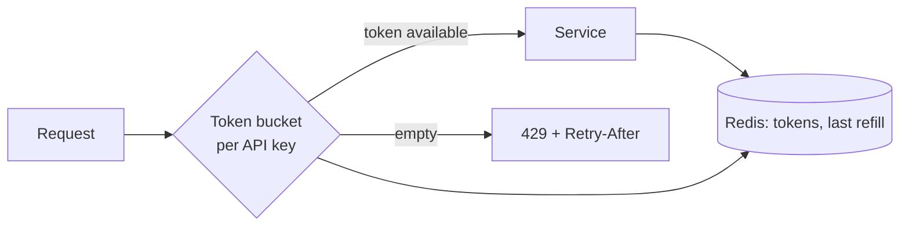

Decides how much traffic each caller may send, and rejects the rest
cheaply. Protects capacity and enforces fairness.

# Rate limiter

## What it is

A component that allows up to N operations per unit time per identity (user, API key, IP,
tenant) and rejects the excess — usually with HTTP 429 and a `Retry-After` header.

## The algorithms

| Algorithm | How it works | Bursts | Notes |
| --- | --- | --- | --- |
| **Fixed window** | Counter per window; reset at the boundary | Allows 2× at the boundary | Simplest; the boundary bug is real |
| **Sliding window log** | Timestamps of each request in the window | Precise | Memory grows with traffic |
| **Sliding window counter** | Weighted average of current and previous window | Near-precise | The usual production compromise |
| **Token bucket** | Tokens refill at rate r, bucket holds b; each request takes one | Yes, up to b | Allows controlled bursts; the best default |
| **Leaky bucket** | Queue drains at a fixed rate | No — smooths output | Adds latency |

Token bucket is the right answer for most systems: `capacity` sets the burst, `refill rate`
sets the sustained rate, and the two are independent knobs.

## Distributed rate limiting

If several gateway instances each enforce "100/min", a client sending to all of them gets
N×100. Two honest options:

1. **Centralised counters in Redis** with an atomic script (`INCR` with expiry, or a Lua
   token-bucket update). Accurate; adds a Redis round trip per request and makes Redis a
   hard dependency.
2. **Local limits with a global budget split** — each instance gets `total / instances` and
   syncs periodically. Approximate, no extra hop, and fine when the limit is a guardrail
   rather than a billing meter.

## What to limit, and where

- **Per API key / tenant** — fairness and quota. Always.
- **Per IP** — abuse and scraping; beware of NAT where thousands of users share an IP.
- **Per endpoint** — expensive endpoints get tighter buckets than cheap ones.
- **Global concurrency limit** — a semaphore per dependency, so you shed load instead of
  queueing forever.

## Trade-offs

1. **Rejected requests are a product decision.** A 429 is better than a timeout, but it must
   be documented and have a `Retry-After`.
2. **Shared state is a bottleneck.** Redis-based limiting adds latency and a failure mode.
3. **Fairness versus throughput.** Strict per-tenant limits leave capacity idle; work
   conserving limits let one tenant take everything.
4. **The limiter can be the outage.** If Redis is down and you fail closed, you have taken
   down the API with your protection mechanism. Fail open with logging for guardrails; fail
   closed only for billing meters.

## Failure modes

- **Fixed-window boundary burst** — 100 requests at 12:00:59 and 100 more at 12:01:00.
- **Counter key never expires** — memory leak that takes months to notice.
- **Limiting after authentication but before caching** — cheap cached responses get throttled
  as if they were expensive.
- **No jitter in `Retry-After`** — every rejected client returns at the same instant.

## Interview soundbite

> "Token bucket per API key at the gateway, 100 requests per minute sustained with a burst of
> 200, counters in Redis via an atomic Lua update. Separate, tighter buckets on the expensive
> search endpoint, and 429 with a jittered Retry-After."

## Where to go next

- [Token bucket implementation](../code/token-bucket.md).
- [Design a rate limiter](../case-studies/rate-limiter-service.md).
- [Too many requests → rate limit](../patterns/too-many-requests-rate-limit.md).
