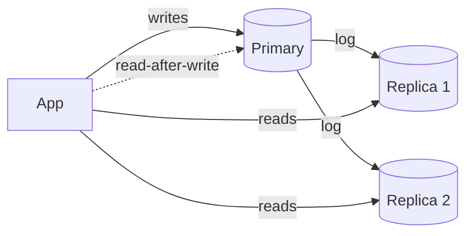

Copies of a database that serve reads. The cheapest way to multiply read
capacity, provided you can live with lag.

# Read replicas

## What it is

A primary accepts writes and streams its change log to followers, which apply it and serve
reads. Followers also serve as failover candidates and as sources for analytics without
touching the primary.

## How it works

- **Log shipping** — the primary writes its WAL/binlog; followers apply it. Asynchronous by
  default.
- **Semi-synchronous** — the primary waits for one follower to acknowledge before committing.
  Bounds the data-loss window; adds a round trip.
- **Lag** — measured in seconds (or bytes behind). It spikes when the primary is write-heavy,
  when a follower restarts, or when a long transaction blocks apply.
- **Read routing** — the application, a proxy, or a driver decides which node serves a query.

## When to reach for it

- Reads dominate and the queries are varied (a cache would miss too often).
- You need a failover target for availability, regardless of load.
- Analytics needs to run without competing with production traffic.
- You need a replica in another region to serve reads locally.

## Trade-offs

1. **Staleness.** Reads may not reflect the latest write. This is a user-visible bug unless
   handled — see read-your-writes below.
2. **Writes are still single-node.** Replicas do nothing for write throughput. If writes are
   the constraint, this is the wrong tool.
3. **Cost and complexity.** Each replica is a full copy, a backup job, and a monitoring
   target.
4. **Failover is a decision, not a switch.** Promotion loses the unshipped portion of the
   log, and the old primary must be fenced off or you get split-brain.

## Handling read-your-writes

Three approaches, cheapest first:

- **Route the user to the primary for a window** (say 5–10 seconds) after they write. Simple,
  effective, slightly uneven.
- **Version tokens** — return the write's LSN/version; require the replica to have reached it.
- **Session pinning** — a user sticks to one replica, guaranteeing monotonic reads.

## Failure modes

- **Replica lag during a bulk write** — a nightly job makes every replica minutes behind, and
  users see old data at 2 a.m. Throttle bulk writes, or route them to a dedicated replica.
- **Cascading replication** — a replica of a replica amplifies lag. Keep it shallow.
- **Read routing that forgets transactions** — a read inside a transaction routed to a replica
  breaks atomicity.
- **Replica never catching up** — long-running queries or missing indexes on the replica cause
  apply lag; fix the replica's workload.

## Interview soundbite

> "Reads go to replicas, and any read inside a transaction or immediately after a user's own
> write goes to the primary. I'd alarm on replica lag above two seconds, because that is where
> the read-your-writes window stops being safe."

## Where to go next

- [Replication and partitioning](../fundamentals/replication-and-partitioning.md).
- [Read-heavy DB → replicas](../patterns/read-heavy-replicas.md).
