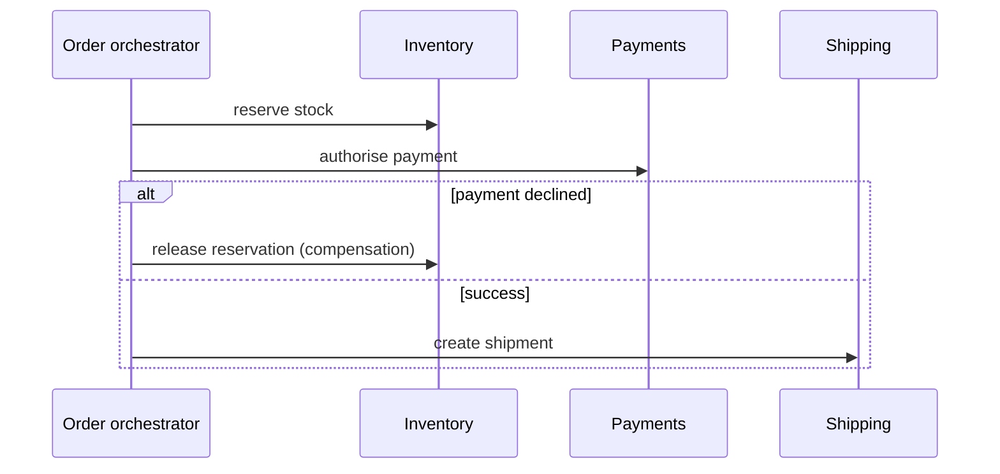

How to keep a multi-service business process consistent without a
distributed transaction: do the steps, and undo them explicitly when a later step fails.

# Sagas and workflows

## What it is

A saga is a sequence of local transactions across services. Each step commits locally and
publishes an event or invokes the next step. If a step fails, previously completed steps are
undone by **compensating actions**.

A compensation is not a rollback — the original work really happened, and the compensation is
a new action that reverses its effect (refund, cancel, release the reservation).

## Two shapes

**Orchestration** — a coordinator (a workflow engine or a service) calls each step and decides
what to do on failure. Explicit, debuggable, and the coordinator becomes a component to own.

**Choreography** — services react to each other's events; there is no central brain. Loosely
coupled, and hard to see the whole flow when something goes wrong at 3 a.m.

## Designing compensations

| Step | Compensation | Note |
| --- | --- | --- |
| Reserve inventory | Release reservation | Safe if the reservation is idempotent |
| Charge card | Refund | Visible to the customer; prefer authorise-then-capture |
| Send email | Send correction | Some effects cannot be undone |
| Create shipment | Cancel before dispatch | Depends on the real world, not the database |

Two rules: **every step needs a compensation, or an explicit "this cannot be undone" note**;
and **compensations must be idempotent**, because they will be retried.

## Semantics you must accept

- **No isolation.** Other transactions can see intermediate states — stock reserved but not
  paid. Design the UI and the reads for it ("reserved for 10 minutes").
- **No atomicity.** A failure mid-way leaves a partially completed process that must be
  driven to a terminal state.
- **Eventual completion.** The process ends, eventually, in success or compensated failure.
  Nothing should stay "in progress" forever — add a timeout and a terminal state.

## Practical machinery

- **Persist the saga state** (a state machine table) so a crash resumes rather than forgets.
- **Idempotency keys** on every step.
- **Timeouts per step**, with escalation.
- **Outbox pattern** to publish step events transactionally.
- **A dead-letter path** for sagas that cannot complete — a queue of orders needing a human.

## Trade-offs

1. **Complexity.** You are writing a distributed state machine that must handle every failure
   ordering.
2. **Visible intermediate states.** Your data is inconsistent for seconds or minutes, by
   design.
3. **Compensations can fail** — a refund can be rejected. Then you need a manual path, and
   someone must own it.
4. **Testing is hard.** The interesting cases are partial failures, which are exactly the ones
   that are awkward to simulate.

!!! tip "The cheaper alternative"
    Before designing a saga, ask whether the steps can be reordered so the risky step happens
    last, or whether the data can live in one database so a single local transaction suffices.
    Many sagas exist because two services were split for organisational rather than technical
    reasons.

## Interview soundbite

> "Checkout is a saga with an orchestrator: reserve stock, authorise payment, create the
> shipment. If authorisation fails, the orchestrator releases the reservation; the reservation
> is held for ten minutes so a stuck saga expires instead of blocking inventory forever."

## Where to go next

- [ACID, BASE and transactions](../fundamentals/transactions.md).
- [Payments and ledger case study](../case-studies/payments-ledger.md).
