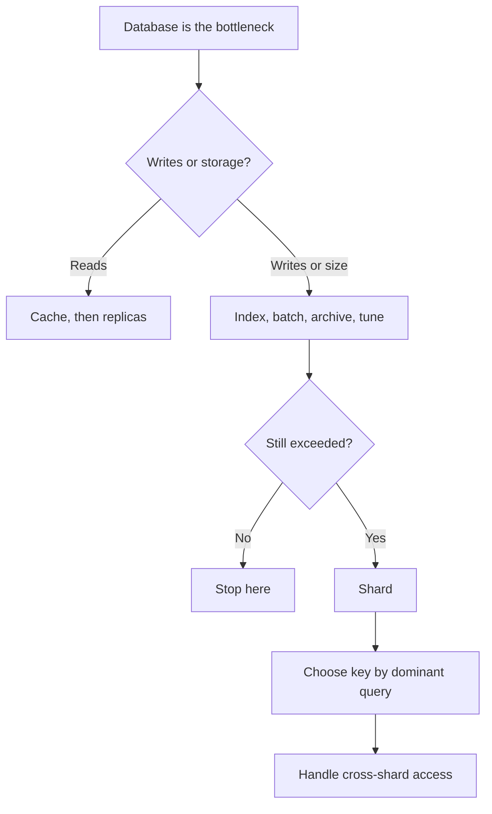

Splitting one logical database into independent pieces so writes and
storage can exceed a single machine. Powerful, permanent, and the most common place to
introduce a decade-long mistake.

# Sharding

## What it is

Horizontal partitioning of rows across separate database instances, by a **shard key**.
Each shard is an independent database with its own resources and its own failure domain.

Read [replication and partitioning](../fundamentals/replication-and-partitioning.md) for the
strategies. This page is about doing it.

## The decision sequence

Every step before "shard" is reversible. Sharding is not.

## Choosing the key

Score candidate keys against four tests:

| Test | Question |
| --- | --- |
| Query locality | Does the dominant query include this key, so it stays single-shard? |
| Distribution | Is it even? Any key that is 100× larger for one tenant is a hot shard. |
| Stability | Will it ever need to change? Re-keying is a migration project. |
| Co-location | Does it group rows that are used together (a tenant's orders and invoices)? |

Common choices: `user_id` (social), `tenant_id` (B2B), `conversation_id` (chat),
`hash(short_code)` (URLs), `order_id` (commerce, if queries are by order).

Bad choices: `created_at` (every recent write to one shard), `country` (uneven),
`status` (two shards, one hot).

## The mechanics that make it survivable

- **Logical shards mapped to physical nodes.** Create 1,024 logical shards, place them on
  N physical nodes via a lookup table. Growing from 16 to 32 nodes is a metadata change plus
  background data movement, not a re-key.
- **Consistent hashing** if you cannot keep a lookup table. Adding a node moves ~1/N of keys.
- **A routing layer** in the application or a proxy (Vitess, ProxySQL, Citus) so services do
  not hard-code shard locations.
- **Shard-aware IDs** — generate IDs that encode the shard (Snowflake-style) so a lookup by ID
  is single-shard.
- **A global ID service** if you need ordering across shards.

## Trade-offs

1. **Cross-shard joins become application code** or a separate analytical store.
2. **Cross-shard transactions become sagas** — or are avoided by choosing a key that keeps
   them local.
3. **Aggregates require scatter-gather** — `COUNT(*)` over all users is now N queries.
4. **Secondary indexes are local or global**, and both have costs: local means fan-out on
   query, global means an asynchronously maintained index.
5. **Operational surface multiplies** — N times the backups, migrations, monitoring, and
   failure modes.
6. **Rebalancing is a background data-movement project** that must not disturb production.

## Failure modes

- **Hot shard** — one celebrity or enterprise tenant melts one node. Fix with a dedicated
  shard, key salting, or a cache in front.
- **Cross-shard query in a hot path** — someone writes a dashboard query that fans out to
  1,024 shards.
- **Uneven growth** — hash distribution is even by key count, not by bytes; one shard fills
  first.
- **Split-brain during resharding** — writes accepted on both sides of a move. Needs a
  careful cutover with a fence.

## Interview soundbite

> "I'd shard by `tenant_id` because every query is tenant-scoped, so it stays single-shard.
> 1,024 logical shards on 16 physical nodes, mapped in a small table, so growing the cluster
> is a metadata change. Cross-tenant reporting moves to ClickHouse, where it belongs."

## Where to go next

- [Write-heavy DB → shard](../patterns/write-heavy-shard.md).
- [Shard router implementation](../code/sharding.md).
- [Consistent hashing](../code/consistent-hashing.md).
