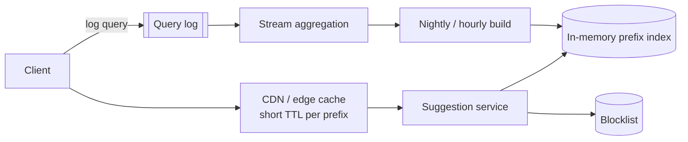

<p class="lead">Return ten ranked suggestions for a prefix as the user types, in under a hundred
milliseconds, on popularity that changes hourly.</p>

# Design search autocomplete

## 1 · Requirements

**Functional**

- Given a prefix, return the top 10 completions ranked by popularity.
- Update rankings as query popularity shifts.
- Personalise lightly (recent queries, locale).
- Filter unsafe or banned terms.

**Non-functional**

- Under 100 ms end-to-end at p99, including network.
- Available under extreme read volume; it is on the typing path.
- Ranking freshness measured in minutes, not seconds.
- Must degrade gracefully — an empty suggestion list is acceptable, a slow one is not.

## 2 · Estimates

| Quantity | Assumption | Result |
| --- | --- | --- |
| Queries | 1B searches per day, 5 keystrokes each | ~5B lookups/day → ~60k QPS, ~200k at peak |
| Distinct prefixes | ~10M meaningful prefixes | Fits in memory with a compact structure |
| Top-k per prefix | 10 entries × ~50 B | ~5 GB — one or a few in-memory nodes |
| Log volume | 1B query events per day | Aggregated in a stream job |

## 3 · API

```http
GET /suggest?q=sys&limit=10&locale=en -> 200 {suggestions: [{text, score}]}
POST /queries  {query, user_id, ts} -> 202
```

## 4 · Data model

| Store | Key | Notes |
| --- | --- | --- |
| Trie / prefix index | prefix | Top-k list per node, precomputed |
| `query_counts` | `query, hour` | Aggregated counts from the stream job |
| `blocklist` | `term` | Filtered at build time and at query time |

## 5 · High-level design



## 6 · Deep dives

### The index: a trie with top-k at each node

A trie maps characters to child nodes, so walking `s → y → s` lands on the subtree containing all
`sys*` terms. Precompute the top 10 completions at each node, and a lookup is a walk of three
pointers plus a list read — microseconds.

Memory is the constraint. A naive trie over 10M queries is large, so compress: merge single-child
chains into one node (a radix tree), store top-k only at nodes with enough traffic, and use
offsets into flat arrays rather than per-node objects. This is the difference between 20 GB and
2 GB.

### Freshness without rebuilding constantly

Rebuilding the whole index on every new query is impossible at 60k QPS of lookups and millions of
writes.

The pattern: log queries to a stream, aggregate counts in a rolling window (last hour, last day,
last week), and rebuild the top-k per prefix periodically — hourly for hot prefixes, daily for the
long tail. Merge the layers with weights so a term trending in the last hour can outrank a term
that has been popular for a year.

Serving stays read-only against an immutable index that is swapped in atomically.

### The latency budget

100 ms end to end:

| Stage | Budget |
| --- | --- |
| Network to edge | 20 ms |
| Edge cache hit | 1 ms |
| Service + index walk | 5 ms |
| Serialisation | 2 ms |
| Client rendering | 20 ms |
| Headroom | 50 ms |

Cache aggressively at the edge — suggestions for a prefix are identical for most users, so a
short TTL (30–60 seconds) absorbs most traffic. Personalisation has to be applied client-side or
as a cheap re-rank, or it destroys cacheability. Saying that trade-off is the point.

### Debounce and cancellation

A client-side concern that belongs in the design: debounce keystrokes to ~100 ms, cancel in-flight
requests for superseded prefixes, and never show results for a prefix the user has already typed
past. Without it, the service sees five times the traffic and users see flickering suggestions.

## 7 · Bottlenecks

| Symptom | Fix | Cost |
| --- | --- | --- |
| 200k QPS at peak | Edge cache with short TTL; replicate the index | Up to a minute of staleness |
| Index memory | Radix compression; top-k only on hot nodes | Rare prefixes get no suggestions |
| Build cost | Incremental build for hot prefixes only | Long-tail rankings refresh daily |
| Personalisation | Client-side re-rank of the top 10 | Weaker personalisation |

## 8 · Failure story

- An index node failing means its prefixes return empty suggestions — the search box still works,
  because suggestions are an enhancement and must never block a search.
- A stale index serves yesterday's ranking; acceptable, and bounded by the build schedule.
- The aggregation job falling behind does not affect serving at all — that separation is deliberate.
- A blocked term is filtered both at build time and at query time, so a bad entry cannot leak
  between builds.

## Interview soundbite

> "A radix-compressed trie with the top ten completions precomputed at each node, so a lookup is a
> three-pointer walk. Rankings are rebuilt hourly from stream-aggregated query counts and swapped in
> atomically, and the edge caches each prefix for 60 seconds, because suggestions are identical for
> almost everyone."

## Where to go next

- [Search index](../building-blocks/search-index.md)
- [Slow reads → cache](../patterns/slow-reads-cache.md)
- [Batch and stream processing](../building-blocks/batch-and-stream.md)
