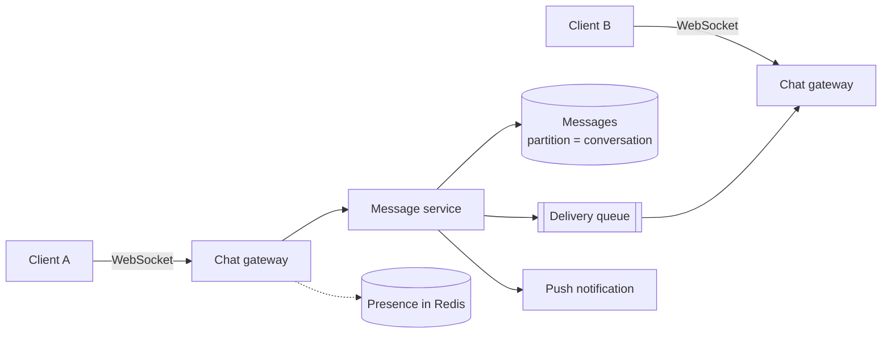

<p class="lead">One-to-one and group messaging with delivery guarantees, ordering per conversation,
and presence.</p>

# Design a chat system

## 1 · Requirements

**Functional**

- Send a message to a user or a group.
- Receive messages in real time when online.
- Paginated message history.
- Read receipts and typing indicators.

**Non-functional**

- Sub-second delivery when online; push notification otherwise.
- Messages in a conversation appear in the same order for everyone.
- No message loss once the sender is acknowledged.
- At-least-once delivery, so clients dedupe by message ID.

## 2 · Estimates

| Quantity | Assumption | Result |
| --- | --- | --- |
| Messages | 50M DAU × 40/day | 2B/day → ~23k QPS, ~70k at peak |
| Message size | 200 B | ~400 GB/day, ~150 TB/year |
| Connections | 10M concurrent | ~1k–10k per gateway node |
| History reads | 20 messages per open | Recent messages dominate |

## 3 · API

```http
WebSocket /chat  (persistent, authenticated)

POST /conversations                          -> 201 {conversation_id}
POST /conversations/{id}/messages            {client_msg_id, text} -> 201 {message_id, seq}
GET  /conversations/{id}/messages?before=seq -> 200 {items[]}
POST /conversations/{id}/read                {seq} -> 204
```

## 4 · Data model

| Table | Key | Notes |
| --- | --- | --- |
| `messages` | `conversation_id, seq` | Wide-column: one partition per conversation, ordered |
| `conversations` | `conversation_id` | members[], type, created_at |
| `user_inbox` | `user_id, ts` | Conversations by last activity |
| `presence` | `user_id` | Redis with a heartbeat TTL |

## 5 · High-level design



## 6 · Deep dives

### Per-conversation ordering

Global ordering is unnecessary and expensive. What users need is that everyone sees the same
order within a conversation. Partition the store by `conversation_id` and assign a monotonic
`seq` per conversation — a single writer per partition gives that for free.

Clients sort by `seq` and use it for gap detection: "I have 41, 42, 44, so I am missing 43",
which they fetch explicitly. That is how a reliable chat UI sits on top of at-least-once
delivery.

### Connection management at 10M sockets

Each gateway node holds a bounded number of sockets. Sockets are pinned to a node, so the
routing table is "user → gateway node", held in Redis and refreshed by heartbeat.

When a user reconnects to a different node, the table is updated and queued messages drain from
their inbox. Do not try to keep sockets balanced — keep the messages routable.

### Delivery guarantees and offline users

The path is: persist the message, acknowledge the sender, then attempt delivery. Delivery is
at-least-once; the queue redelivers and the client dedupes on `message_id`.

Offline users get a push notification and a backlog drain on reconnect. The backlog must be
bounded — a user away for a month should not receive a million messages on open; cap it and
offer "jump to latest".

## 7 · Bottlenecks

| Symptom | Fix | Cost |
| --- | --- | --- |
| Too many sockets per node | Shard connections by user_id | Reconnect storm when a node dies |
| 70k message QPS | Partition by conversation; batch fsyncs | A few ms extra latency |
| History reads | Cache the last 50 messages per active conversation | Seconds of staleness |
| 500-member group fan-out | Write once, deliver to N routes, queue for offline | Eventually consistent delivery |

## 8 · Failure story

- A gateway node dying drops sockets; clients reconnect elsewhere and drain their inbox.
- Duplicate delivery is expected and handled by client-side dedupe on `message_id`.
- Losing a messages partition means losing one conversation's history — so replication factor
  three and backups are non-negotiable.
- "Sent but not delivered" is visible to the sender as one tick versus two, which keeps the
  guarantee honest.

## Interview soundbite

> "Partition messages by conversation_id and assign a per-conversation sequence number, so
> ordering is a property of the partition rather than a distributed problem. Delivery is
> at-least-once over the queue with client-side dedupe, and presence lives in Redis with a
> heartbeat TTL."

## Where to go next

- [Message queue](../building-blocks/message-queue.md)
- [Delivery semantics](../fundamentals/delivery-semantics.md)
- [Networking for system design](../fundamentals/networking.md)
