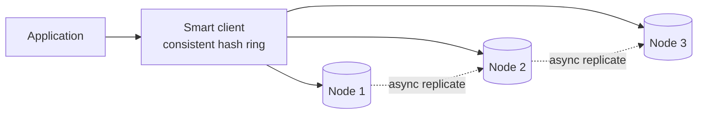

<p class="lead">Build the thing you usually just use: a sharded, replicated, consistent-hashed
cache with eviction, expiry, and a failure story.</p>

# Design a distributed cache

## 1 · Requirements

**Functional**

- `get(key)`, `set(key, value, ttl)`, `delete(key)`.
- Evict when memory is full.
- Scale horizontally by adding nodes.

**Non-functional**

- Sub-millisecond median, low single-digit milliseconds at p99.
- Adding a node moves a small fraction of keys, not most of them.
- Survive losing a node without a total cache wipe.
- No single coordinator on the request path.

## 2 · Estimates

| Quantity | Assumption | Result |
| --- | --- | --- |
| Throughput | 1M ops/s across the cluster | ~100k ops/s per node, so ~10 nodes |
| Working set | 500 GB | ~50 GB RAM per node with headroom |
| Object size | ~10 KB average | ~50M objects per node |
| Hit rate target | 95%+ | Misses hit the origin, so this bounds origin load |

## 3 · API

```text
get(key)              -> value | miss
set(key, value, ttl)  -> ok
delete(key)           -> ok
mget(keys[])          -> values[]     # batch: one round trip, not N
```

## 4 · Data model

| Structure | Purpose |
| --- | --- |
| Hash table | key → (value pointer, expiry, LRU metadata) |
| Doubly linked list | LRU ordering, O(1) move on access |
| Hash ring | key → node mapping (consistent hashing) |
| Replica set | 2 nodes per key range, for availability |

## 5 · High-level design



## 6 · Deep dives

### Consistent hashing, with virtual nodes

Plain `hash(key) mod N` remaps nearly every key when N changes — adding one node to a ten-node
cluster moves 90% of keys, and the origin is flooded by misses.

Consistent hashing places nodes and keys on the same ring; a key belongs to the next node
clockwise. Adding a node moves only the keys in its arc, roughly 1/N.

The problem is balance: with ten nodes the arcs are uneven, so one node can own 30% of the
keyspace. The fix is **virtual nodes** — each physical node appears as 100–200 points on the ring,
so load evens out and a failed node's keys are spread across all survivors rather than dumped on
one.

```python
# concept
ring = sorted((hash(f"{node}#{i}"), node) for node in nodes for i in range(150))
def owner(key):
    h = hash(key)
    idx = bisect_left(ring, (h,))
    return ring[idx % len(ring)][1]
```

### Eviction and expiry are different things

**Eviction** happens when memory is full: pick a victim by LRU, LFU, or a sampled approximation.
**Expiry** happens because the entry's TTL passed: it must never be returned, even if memory is
plenty.

Conflating them is a common bug. Implementation notes that matter:

- Expiry is checked on read (lazy) plus a background sweep, so memory is reclaimed even for keys
  that are never read again.
- LRU needs O(1) updates; the standard trick is a hash map plus a doubly linked list, or an
  approximate clock/sampled-LRU to avoid locking the whole structure.
- Never return an expired value under any circumstances — that is a correctness bug, not a
  performance one.

### Failure handling: what happens when a node dies

Options, in increasing order of cost:

- **Fail the request** — the client sees a cache miss and falls back to the origin. Simple, but a
  node death sends its whole keyspace to the origin at once.
- **Replicate each key to the next node on the ring** — reads fall over to the replica; the origin
  never sees the spike. Costs roughly 2× memory.
- **Rebalance the ring immediately** — smoother, but a data-movement event during a failure is
  usually the wrong time to add load.

Most production caches choose replication with asynchronous writes, accepting that the replica may
be slightly behind.

## 7 · Bottlenecks

| Symptom | Fix | Cost |
| --- | --- | --- |
| One hot key | Replicate that key with a random suffix; cache in-process | Slightly stale reads |
| Node at capacity | Add a node; only ~1/N of keys move | Some misses during the move |
| Lock contention | Per-shard locks or a lock-free sampled LRU | Approximate recency |
| Big values | Store a reference to object storage instead | An extra fetch on hit |

## 8 · Failure story

- A node dying is invisible to the application if keys are replicated; without replication, expect
  a miss storm and a slow origin for a minute.
- A network partition must not produce two owners for one key — the ring is computed from cluster
  membership, so a partitioned node is removed and its replica takes over.
- Losing the whole cache is survivable by definition; the question is whether the origin can
  survive the resulting load. If not, you need a load shedder, not a better cache.
- TTLs are set by callers, so a caller that forgets one leaks memory — enforce a maximum TTL
  server-side.

## Interview soundbite

> "Consistent hashing with about 150 virtual nodes per physical node, so adding a node moves roughly
> 1/N of keys instead of all of them, and each key is asynchronously replicated to the next node so
> a node death is a cache miss rather than a wipe."

## Where to go next

- [Consistent hashing implementation](../code/consistent-hashing.md)
- [Cache](../building-blocks/cache.md)
- [Caching theory](../fundamentals/caching.md)
