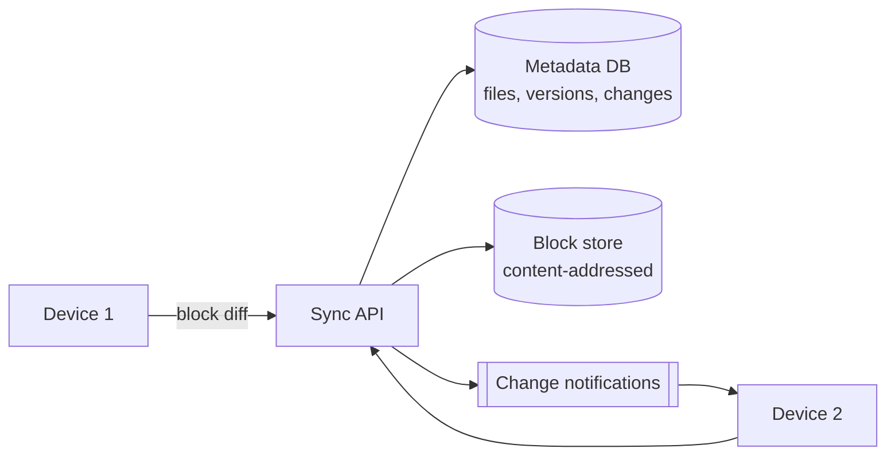

<p class="lead">Store files in the cloud and keep a folder in sync across a user's devices, including
offline edits.</p>

# Design a file storage and sync service

## 1 · Requirements

**Functional**

- Upload and download files and folders.
- Sync changes across devices automatically.
- Share a folder with another user with permissions.
- Version history and restore.

**Non-functional**

- Conflict resolution must never lose data silently.
- Sync latency of seconds for small files.
- Only changed blocks transfer.
- Storage is the dominant cost; deduplicate aggressively.

## 2 · Estimates

| Quantity | Assumption | Result |
| --- | --- | --- |
| Users | 100M × 50 GB | ~5 EB before dedupe |
| Change rate | 1% of files per day | ~5 PB per day of changed blocks |
| Block size | 4 MB | A 1 GB file is 256 blocks |
| Metadata ops | 10 per user per day | ~12k QPS |

## 3 · API

```http
POST /files                {path, size, content_hash} -> 201 {file_id, missing_blocks[]}
PUT  /blocks/{hash}        (direct to object storage, content-addressed)
GET  /changes?since=cursor -> 200 {changes[], next_cursor}
POST /shares               {path, grantee, permission} -> 201
GET  /files/{id}/versions  -> 200 {versions[]}
```

## 4 · Data model

| Table | Key | Notes |
| --- | --- | --- |
| `file_metadata` | `file_id` | path, owner, size, content_hash, version, updated_at |
| `blocks` | `block_hash` | Content-addressed; object storage key |
| `file_versions` | `file_id, version` | Block list per version, cheap because blocks are shared |
| `changes_log` | `user_id, seq` | Per-user monotonic change stream for delta sync |

## 5 · High-level design



## 6 · Deep dives

### Chunking and content-addressed blocks

Split files into 4 MB blocks and hash each one, or use a rolling hash so an edit does not shift
every subsequent block boundary. The client asks which hashes the server is missing and uploads
only those.

Two consequences worth stating. **Deduplication is free**: identical blocks are stored once, so
a hundred users storing the same PDF costs one copy. **Version history is cheap**: a new version
is a new list of block hashes, sharing almost all blocks with the previous one.

### Conflict resolution

Two devices edit the same file offline. The options:

- **Last writer wins** — simple, silently loses data. Only for low-value files.
- **Keep both** — rename one to `file (conflicted copy).docx`, exactly as desktop clients do.
  Never loses data; occasionally clutters.
- **Operational transform or CRDT** — merge at the character level. Correct, complex, and worth it
  only for collaborative documents, not arbitrary files.

For a general file sync service, "keep both" is the honest answer. The client detects a conflict
by comparing the base version it started from against the server's current version.

### The metadata service is the real system

Blocks are easy — object storage does that. The hard part is metadata: a consistent view of
paths, versions, permissions, and a per-user change log so a device can ask "what changed since
cursor X".

The change log is a monotonically increasing sequence per user or per shared folder, and each
device stores its last cursor. That turns sync into a cheap delta query instead of a full
listing.

## 7 · Bottlenecks

| Symptom | Fix | Cost |
| --- | --- | --- |
| Upload bandwidth | Block-level diffing; compress before upload | More metadata per file |
| Metadata QPS | Cache path lookups; shard by user_id | Cross-user sharing needs a hop |
| Storage cost | Content-addressed dedupe | Garbage collection for unreferenced blocks |
| Many devices polling | Long-poll or WebSocket for changes | Connection state to manage |

## 8 · Failure story

- A device offline for a week syncs by replaying its cursor through the change log. Old cursors
  beyond retention trigger a full resync.
- A partially uploaded file is never visible: the version becomes current only when all blocks
  are present.
- Block store unavailability degrades uploads while downloads continue from cache.
- Losing the metadata database is the catastrophe case, which is why it is replicated and backed
  up separately from the blocks.

## Interview soundbite

> "Files are split into content-addressed blocks, so the client uploads only the hashes the
> server is missing and deduplication falls out for free. The metadata service — paths, versions
> and a per-user change cursor — is the hard part, and conflicts keep both copies rather than
> silently picking a winner."

## Where to go next

- [Object storage](../building-blocks/object-storage.md)
- [Idempotency](../building-blocks/idempotency.md)
- [Consistency models](../fundamentals/consistency.md)
