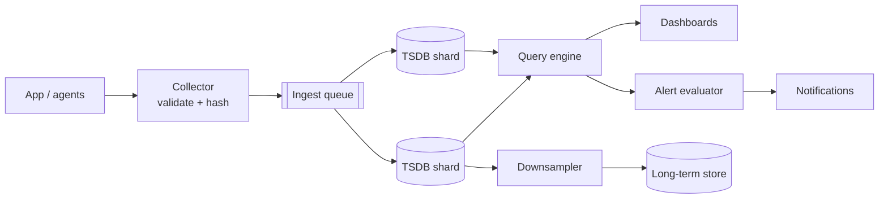

<p class="lead">Ingest millions of measurements per second and answer "what is the p99 for this
service right now" in under a second, cheaply.</p>

# Design a metrics and alerting pipeline

## 1 · Requirements

**Functional**

- Agents push or expose metrics: counters, gauges, histograms, with labels.
- Query by metric and label set over a time range; compute rates, percentiles, aggregates.
- Alerting rules evaluated continuously, with notifications.
- Retention: raw for days, downsampled for a year.

**Non-functional**

- Ingestion of millions of samples per second.
- Query latency under a second for a dashboard.
- Writes must never block the application that emits them.
- Cardinality must be bounded, or the system dies.

## 2 · Estimates

| Quantity | Assumption | Result |
| --- | --- | --- |
| Samples | 5M per second | ~18 billion per hour |
| Sample size | ~2 B compressed (timestamp, value) | ~10 MB/s per series set — large but manageable |
| Active series | 10M | ~10 GB RAM for the index |
| Retention | 15 days raw, 1 year at 5-minute resolution | ~1 PB raw, ~5 TB downsampled |

## 3 · API

```http
POST /write            (protobuf/remote-write: series + samples) -> 204
GET  /query_range?query=rate(http_requests_total{job="api"}[5m])&start&end&step -> 200 {series[]}
GET  /series?match={__name__="http_requests_total"} -> 200 {series[]}
POST /rules            {expr, for, severity, receiver} -> 201
```

## 4 · Data model

| Component | Shape | Notes |
| --- | --- | --- |
| Series | `metric_name + sorted label set` | The identity; the cardinality unit |
| Sample | `(series_id, timestamp, value)` | Append-only |
| Block | Time-partitioned chunk on disk | Immutable after sealing; enables cheap retention |
| Index | Label → series IDs | Inverted index, memory-resident |

## 5 · High-level design



## 6 · Deep dives

### Cardinality is the whole problem

Every distinct label combination is a series with its own index entry, memory, and disk. A metric
labelled with `user_id` across 10M users is 10M series, and the index alone will exhaust RAM.

The rules that keep this alive:

- Labels must be bounded and known in advance: `service`, `route` (templated, not raw URL),
  `status_class`, `region`.
- Never label with IDs, emails, timestamps, or error messages.
- Enforce at the collector: reject or aggregate series above a per-metric cardinality limit. Doing
  it at ingestion is the only place it works.

### Why the storage looks like a log-structured tree

Time-series data is append-only and almost always queried by time range. So: buffer recent samples
in memory, flush to immutable time-partitioned blocks on disk, and keep an inverted index from
label to series. Queries touch only the blocks overlapping the range.

Immutability makes three things easy: retention (delete a whole block), compression (delta-of-delta
timestamps, XOR floats — the classic Gorilla encoding), and downsampling (roll a block into a
coarser one and drop the original).

### Alerting on burn rate

Evaluating a rule every 15–60 seconds over a rolling window is cheap if the query engine is good.
The interesting design decision is *what* to alert on.

Alert on symptoms users feel — error rate, latency against an SLO — not on causes like CPU. The
burn-rate formulation is the cleanest version: "the error budget is being consumed 10× faster than
sustainable, over five minutes" is a page; 2× over an hour is a ticket. This produces few alerts,
all of them actionable.

Alerts need dedupe and grouping, or one broken dependency produces five hundred pages.

## 7 · Bottlenecks

| Symptom | Fix | Cost |
| --- | --- | --- |
| Ingestion spikes | Queue plus batching; drop non-critical metrics under load | Lossy under pressure, by design |
| Cardinality explosion | Reject at the collector; aggregate at the source | Less granular data |
| Query cost on long ranges | Downsample; limit the max range in the UI | Approximate answers |
| Alert storms | Grouping and dedupe by service and cause | Some alerts folded together |

## 8 · Failure story

- The ingest queue absorbs a spike; if it fills, non-critical metrics are dropped and the drop is
  itself a metric.
- A TSDB shard failing means queries over its series return partial data, flagged as partial in the
  response — never silently wrong.
- The alert evaluator running on stale data must not page; staleness is checked before evaluation.
- Losing a block loses a time range, which is why blocks are replicated within the cluster.

## Interview soundbite

> "Samples are validated at the collector, where cardinality limits are enforced — that is the only
> place it works. Storage is immutable time-partitioned blocks with a label index, which makes
> retention and downsampling a matter of deleting and rolling blocks, and alerts fire on SLO burn
> rate rather than on CPU."

## Where to go next

- [Observability](../building-blocks/observability.md)
- [Batch and stream processing](../building-blocks/batch-and-stream.md)
- [Cannot see what broke → telemetry](../patterns/cannot-see-what-broke-telemetry.md)
