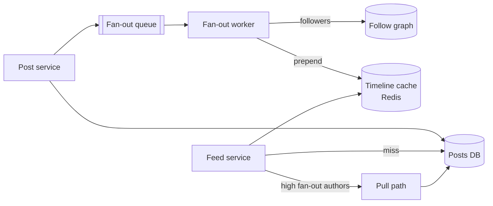

<p class="lead">Assemble a personalised, ordered feed from the posts of everyone a user follows.
The interview is about fan-out.</p>

# Design a news feed

## 1 · Requirements

**Functional**

- Follow and unfollow users.
- Post text and media.
- Read a paginated feed of posts from followees, newest first, lightly ranked.
- Like counts, eventually consistent.

**Non-functional**

- Feed read latency under 200 ms at p95.
- Feed may be up to about five seconds stale.
- Read:write ratio around 100:1.
- A user with 10M followers must not break the system.

## 2 · Estimates

| Quantity | Assumption | Result |
| --- | --- | --- |
| DAU | 50M | — |
| Feed reads | 20 per user per day | 1B/day → ~10k QPS, ~30k at peak |
| Posts | 2 per user per day | 100M/day → ~1k QPS |
| Timeline cache | 500 entries × 200 B × 50M users | ~5 TB in Redis — the expensive number |
| Post storage | 100M posts/day × 1 KB | 100 GB/day, ~36 TB/year |

## 3 · API

```http
POST   /posts                  {text, media_ids[]} -> 201 {post_id}
GET    /feed?cursor=...                            -> 200 {items[], next_cursor}
POST   /follows/{user_id}                          -> 204
DELETE /follows/{user_id}                          -> 204
GET    /users/{id}/posts?cursor=...                -> 200 {items[]}
```

## 4 · Data model

| Table | Key | Notes |
| --- | --- | --- |
| `posts` | `post_id` (time-sortable) | author_id, text, media, created_at |
| `follows` | `follower_id, followee_id` | Both directions indexed |
| `timelines` | `user_id, post_id` | Precomputed entries, capped at ~800 per user |
| `counts` | `post_id` | Approximate like and comment counters |

## 5 · High-level design



## 6 · Deep dives

### Fan-out on write versus read

**Push (fan-out on write).** When a user posts, write the post ID into every follower's
timeline. Reads become a single cache lookup, which is why feeds feel instant. The cost: a post
by a user with 10M followers is 10M writes.

**Pull (fan-out on read).** At read time, fetch posts from every followee and merge. Writes are
cheap; reads fan out to hundreds of queries, which does not survive a 200 ms p95.

The production answer is **hybrid**: push for ordinary users, pull for high-fan-out accounts,
merged at read time with a recency threshold such as "pull only from the last 24 hours".

### The celebrity problem, quantified

With an average of 200 followers, a post is 200 timeline writes. At 1k posts per second that is
200k writes per second, which a sharded Redis handles comfortably.

Now one account with 10M followers posts. That is a single event producing 10M writes. Even at
100k writes per second it takes 100 seconds, and the queue backs up behind it.

The fix is not more workers — it is to treat high-fan-out authors differently. Do not push at
all, mark them pull-only, and merge their recent posts at read time. The read path pays a little
more for those users; the write path stops having cliffs.

### Ordering and pagination

Cursor pagination on `(created_at, post_id)`, not offsets. Offsets get slower with depth and
skip items when new posts arrive — which in a feed is constant.

Keep a cheap score (recency, engagement, affinity) computed at fan-out time and stored with the
timeline entry, so the read path is a sort over 800 entries rather than a ranking pipeline.

## 7 · Bottlenecks

| Symptom | Fix | Cost |
| --- | --- | --- |
| Celebrity fan-out | Hybrid push/pull | More read work for those authors |
| Timeline memory | Cap at 800 entries; cold users to a wide-column store | Deep pagination hits the DB |
| 30k read QPS at peak | Sharded Redis by user_id | Cost, not complexity |
| Follow graph queries | Cache follower lists; shard by user_id | Unfollow propagates slowly |

## 8 · Failure story

- A fan-out backlog delays freshness — visible as "my post is not on my follower's feed yet",
  bounded by alerting on queue age.
- Losing a timeline shard means those users fall back to a pull: slower, still correct.
- A deleted post is filtered on read and purged in the background.
- A follow/unfollow race is resolved by the follow graph being the source of truth; timelines are
  a cache and can be rebuilt.

## Interview soundbite

> "Hybrid fan-out: push post IDs into follower timelines for normal users so reads are one cache
> lookup, and pull at read time for very high follower counts so a single post never becomes ten
> million writes. Cursor pagination on created_at plus post_id, because offsets skip items in a
> feed that changes constantly."

## Where to go next

- [Slow reads → cache](../patterns/slow-reads-cache.md)
- [Write spikes → queue](../patterns/write-spikes-queue.md)
- [Consistency models](../fundamentals/consistency.md)
