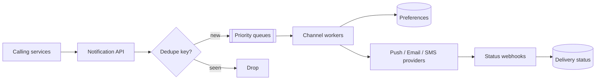

<p class="lead">Deliver the right message to the right person on the right channel, without
sending it twice, and without being rate limited into oblivion by your providers.</p>

# Design a notification system

## 1 · Requirements

**Functional**

- Accept notification requests from other services: user, template, channel, payload.
- Deliver over push, email, SMS and in-app inbox.
- User preferences: per-channel opt-in, quiet hours, digest instead of instant.
- Retries and delivery status per message.

**Non-functional**

- At-least-once delivery with dedupe, because duplicates are user-visible and embarrassing.
- Priority: transactional (OTP, receipt) beats marketing.
- Provider rate limits must be respected, per channel and per provider.
- Throughput in the thousands per second at peak.

## 2 · Estimates

| Quantity | Assumption | Result |
| --- | --- | --- |
| Notifications | 200M per day | ~2,300/s average, ~10k at peak |
| Channels | 4 | Each with its own provider, limits, and failure modes |
| Template store | 10k templates | Trivial; cached aggressively |
| Status rows | 200M/day | ~40 GB/day — partition by day, expire after 90 days |

## 3 · API

```http
POST /notifications
     {user_id, template_id, channels[], data, dedupe_key?, priority?} -> 202 {notification_id}
GET  /notifications/{id}   -> 200 {statuses: {push: delivered, email: bounced}}
PUT  /preferences/{user_id} {channels, quiet_hours, digest} -> 204
```

## 4 · Data model

| Table | Key | Notes |
| --- | --- | --- |
| `notifications` | `notification_id` | user, template, priority, created_at |
| `deliveries` | `notification_id, channel` | status, attempts, provider message ID |
| `preferences` | `user_id` | per-channel opt-in, quiet hours, locale |
| `dedupe` | `dedupe_key` | TTL 24 h, unique constraint |

## 5 · High-level design



## 6 · Deep dives

### Priority queues, because a receipt is not a promotion

Two classes of traffic with opposite requirements. Transactional messages (OTP, payment receipt,
password reset) must go now and must not be delayed behind a marketing blast. Marketing can wait,
and is better batched anyway.

Separate queues with separate consumer pools, so a marketing backlog cannot starve an OTP. This is
a bulkhead, and it is the single most important decision on this page: a delayed OTP is a support
incident, a delayed newsletter is not.

### Dedupe, because users notice

`dedupe_key` is supplied by the caller — for example `receipt:order_123`. The unique constraint on
insert makes a duplicate a no-op. Without this, a retried upstream request sends two emails, and
users lose trust in the whole product.

Channel-level dedupe is a second layer: do not send the same email and push within 30 seconds of
each other. That is a preference-aware rule evaluated at send time, not at enqueue time.

### Provider rate limits are the real constraint

Each provider enforces limits — messages per second, per day, per recipient, and reputation-based
throttles for email. Three consequences:

- **Per-provider token buckets** in the worker pool, not a global rate limit.
- **Multiple providers per channel** with failover when one starts rejecting.
- **Backoff on 429 with the provider's `Retry-After`**, and a circuit breaker per provider so a
  failing one stops absorbing capacity.

Email adds a reputation dimension: a high bounce or complaint rate gets you throttled or blocked
entirely. So suppression lists, bounce handling and unsubscribe processing are part of the system,
not an afterthought.

### Preferences and quiet hours

Evaluated at send time, not enqueue time, so a user who opts out at 23:59 is not woken at 00:01.
Quiet hours mean a message is *deferred*, not dropped, unless it is transactional — which is
exactly the priority split again.

## 7 · Bottlenecks

| Symptom | Fix | Cost |
| --- | --- | --- |
| 10k/s at peak | Sharded queues per channel; autoscaled workers | More moving parts |
| Provider throttling | Per-provider buckets, multiple providers | Complexity in failover |
| Status table growth | Partition by day, expire after 90 days | Losing long-term history |
| Fan-out to many channels | Per-channel workers reading the same notification | Some channels deliver late |

## 8 · Failure story

- A provider outage trips its breaker and traffic shifts to the secondary provider; messages that
  were in flight are retried with the same dedupe key.
- A worker crash re-delivers, and dedupe makes it invisible to the user.
- A marketing backlog never delays transactional traffic, because they are separate queues and
  separate consumer pools.
- If the preferences store is unavailable, the system fails *closed* for marketing and *open* for
  transactional — again the same split.

## Interview soundbite

> "Separate priority queues for transactional and marketing traffic with their own consumer pools,
> so a campaign backlog can never delay an OTP. Callers supply a dedupe key that is unique-constrained
> on insert, and each provider gets its own token bucket and circuit breaker."

## Where to go next

- [Message queue](../building-blocks/message-queue.md)
- [Rate limiter](../building-blocks/rate-limiter.md)
- [Circuit breaker](../building-blocks/circuit-breaker.md)
