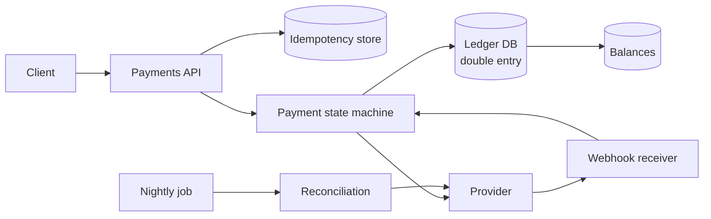

<p class="lead">Move money between accounts without losing any, duplicating any, or being unable
to explain where it went. Correctness first, everything else second.</p>

# Design a payments and ledger service

## 1 · Requirements

**Functional**

- Charge a customer, refund, and transfer between internal accounts.
- Expose a per-account balance and a full transaction history.
- Reconcile against the payment provider daily.

**Non-functional**

- No double charge, ever. Idempotency is not optional.
- Every movement of money is recorded twice: debit and credit.
- Balance and history must agree at all times.
- Latency can be hundreds of milliseconds; correctness cannot be traded.

## 2 · Estimates

| Quantity | Assumption | Result |
| --- | --- | --- |
| Payments | 10M per day | ~120 TPS average, ~600 at peak |
| Ledger rows | 2 per movement (double entry) | 20M rows/day, ~7B/year |
| Row size | ~200 B | ~1.4 TB/year — one primary plus replicas is fine |
| Balance reads | 100 per payment | Cache with a short TTL; never compute from the ledger on the hot path |

## 3 · API

```http
POST /payments            Idempotency-Key: <uuid>
     {account_id, amount, currency} -> 201 {payment_id, status}
POST /refunds             Idempotency-Key: <uuid>
     {payment_id, amount} -> 201 {refund_id, status}
GET  /accounts/{id}/balance -> 200 {available, pending, currency}
GET  /accounts/{id}/entries?cursor=... -> 200 {entries[]}
```

## 4 · Data model

| Table | Key | Notes |
| --- | --- | --- |
| `accounts` | `account_id` | currency, type, status |
| `entries` | `entry_id` | Append-only double-entry rows: account, amount, direction |
| `transactions` | `transaction_id` | Groups entries; exactly balanced |
| `balances` | `account_id` | Materialised running balance, updated in the same transaction |
| `idempotency` | `scope, key` | Unique constraint; stores the response |

## 5 · High-level design



## 6 · Deep dives

### Double-entry bookkeeping

Every movement creates at least two entries that sum to zero: a debit on one account and a credit
on another. There is no "update the balance" operation that stands alone.

Why it matters in an interview: a single-entry ledger can drift, and drift is undetectable. A
double-entry ledger can be audited at any time by summing entries per transaction and checking the
total is zero. That check is a monitoring alert, not a code review.

Balances are a materialised view of entries, updated in the same transaction. The entries are the
truth; the balance is a cache that must be rebuildable.

### Idempotency, applied properly

The client sends a key. The server inserts it into a unique-constrained table in the *same*
transaction as the ledger entries. A replay hits the constraint and returns the stored response.

This matters more here than anywhere else, because a timeout is genuinely ambiguous: the charge may
or may not have happened. Without a key, the only safe client behaviour is to ask a human.

The provider call has its own idempotency key, so the outbound request is safe to retry too. Both
ends need it, because the network is between them.

### Reconciliation

The provider's view and yours will diverge — webhooks arrive late, get lost, or arrive twice. A
nightly job pulls the provider's settlement file and compares it against your ledger, producing
three buckets: matched, missing locally, missing remotely.

Discrepancies are not bugs to hide; they are the input to an operational process. Every payment
system has a reconciliation report and someone who reads it.

### State machines, not booleans

A payment is `pending → authorised → captured → settled`, with `failed` and `refunded` branches.
Each transition is a conditional update guarded by the current state, so a duplicate webhook
cannot move a payment backwards. Modelling this as a boolean `paid` flag is how double refunds
happen.

## 7 · Bottlenecks

| Symptom | Fix | Cost |
| --- | --- | --- |
| Ledger write volume | Batch entries per transaction; shard by `account_id` if needed | Cross-account transfers become sagas |
| Balance reads | Materialised balance, short-TTL cache | Cache staleness must be under the product's tolerance |
| Provider rate limits | Queue with per-provider limits and backoff | Added latency at peak |
| Webhook storms | Dedupe on provider event ID | Requires a store for seen event IDs |

## 8 · Failure story

- An ambiguous timeout is resolved by querying the provider with the same idempotency key, never by
  retrying blindly.
- A webhook arriving twice is a no-op because transitions are guarded by the current state.
- Losing the balance table is recoverable: replay entries to rebuild it. Losing entries is not, so
  the ledger is the most heavily replicated data in the system.
- A provider outage degrades to "accept, queue, capture later" if the business allows authorisation
  without capture; otherwise it is an honest failure.

## Interview soundbite

> "The ledger is append-only double-entry, so every movement is a debit and a credit that sum to
> zero and balances are a rebuildable view of it. The idempotency key is inserted in the same
> transaction as the entries, and the provider call carries its own key — both ends need it because
> the network is in between."

## Where to go next

- [ACID, BASE and transactions](../fundamentals/transactions.md)
- [Idempotency](../building-blocks/idempotency.md)
- [Sagas and workflows](../building-blocks/sagas.md)
