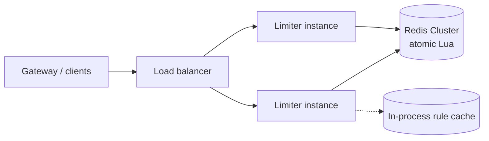

<p class="lead">A shared service that decides whether a request may proceed — fast enough that it
does not become the bottleneck it exists to prevent.</p>

# Design a rate limiter service

## 1 · Requirements

**Functional**

- Enforce N requests per window per API key, with configurable tiers.
- Return 429 with `Retry-After` when exceeded.
- Expose current usage per key.

**Non-functional**

- Decision latency under 5 ms at p99 — it sits on every request path.
- Available: fail open for quota guardrails, closed for billing meters.
- Accurate within a few percent under concurrency.

## 2 · Estimates

| Quantity | Assumption | Result |
| --- | --- | --- |
| Decisions | 500k per second | One Redis shard handles ~100k ops/s, so ~10 shards |
| Active keys | 1M | ~100 MB of counters |
| Latency budget | 5 ms p99 | One Redis round trip is ~0.5 ms |
| Rules | 10k limit configurations | Cached in-process with a 5 s TTL |

## 3 · API

```http
POST /check          {key, cost=1} -> 200 {allowed, remaining}
                                   -> 429 {retry_after_ms}
GET  /usage/{key}                  -> 200 {used, limit, window_start}
PUT  /limits/{key}   {limit, window} -> 204
```

## 4 · Data model

| Store | Key | Notes |
| --- | --- | --- |
| `rules` | `key` | limit, window_seconds, burst, tier |
| `counters` (Redis) | `key` | token count and last-refill timestamp; TTL = window |
| `usage_events` | `key, ts` | Sampled, for the dashboard only |

## 5 · High-level design



## 6 · Deep dives

### Token bucket, atomically

The algorithm must be one atomic operation, or two concurrent requests both read "one token
left" and both proceed. A Lua script does refill-and-decrement in one round trip.

```lua
-- KEYS[1] = counter key
-- ARGV: capacity, refill_per_sec, now, ttl_seconds
local cap    = tonumber(ARGV[1])
local rate   = tonumber(ARGV[2])
local now    = tonumber(ARGV[3])
local tokens = tonumber(redis.call('HGET', KEYS[1], 'tokens') or cap)
local ts     = tonumber(redis.call('HGET', KEYS[1], 'ts') or now)
local refill = math.min(cap, tokens + (now - ts) * rate)
if refill >= 1 then
  redis.call('HSET', KEYS[1], 'tokens', refill - 1, 'ts', now)
  redis.call('EXPIRE', KEYS[1], ARGV[4])
  return 1
end
redis.call('HSET', KEYS[1], 'tokens', refill, 'ts', now)
return 0
```

One round trip, atomic, and the expiry stops the counter table growing forever.

### Scaling to 500k decisions per second

Shard the counter keyspace by `hash(key)` across about ten Redis nodes. Each decision touches
one shard, so there is no scatter-gather.

The interesting question is failure. If a shard is unreachable, do you allow or deny? For a
quota guardrail, allow and log — availability beats accuracy. For a billing meter, deny —
accuracy beats availability. Naming that split per use case is what distinguishes a strong
answer.

### Accuracy versus latency

Fully centralised counters are accurate and cost a round trip. Local buckets per instance,
synced every 100 ms, are faster and up to 100 ms stale, so a client can slightly exceed the
limit during a burst.

The usual compromise: local buckets with a global budget divided by instance count, plus
periodic reconciliation. State the error bound out loud — "at most N × instances requests per
window, and we accept that".

## 7 · Bottlenecks

| Symptom | Fix | Cost |
| --- | --- | --- |
| Redis saturates | Shard by key; pipeline | Cross-key operations become impossible |
| Rules change often | In-process cache with pub/sub invalidation | Up to 5 s stale |
| Counter memory grows | TTL equal to the window | None |
| Boundary bursts | Token bucket, not fixed window | More state per key |

## 8 · Failure story

- A Redis shard outage fails open for guardrails and closed for billing meters — decided per use
  case, not globally.
- The limiter's own endpoints have generous limits so it cannot be used as an amplifier.
- Tightened limits take up to five seconds to apply through the rule cache; that is an SLA, not
  an incident.
- Clock skew between instances affects local buckets only; central refill uses Redis time.

## Interview soundbite

> "Token bucket per key, with refill and decrement in a single Lua script so the decision is one
> atomic round trip, sharded by key to about ten nodes for 500k decisions a second. It fails open
> for quota guardrails and closed for billing meters."

## Where to go next

- [Rate limiter](../building-blocks/rate-limiter.md)
- [Token bucket implementation](../code/token-bucket.md)
- [Too many requests → rate limit](../patterns/too-many-requests-rate-limit.md)
