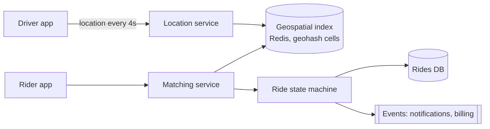

<p class="lead">Match riders to nearby drivers in seconds, with a location stream that never
stops. The interview is about geospatial indexing and freshness.</p>

# Design a ride-hailing service

## 1 · Requirements

**Functional**

- Rider requests a ride from A to B; see a fare estimate.
- Match to a nearby available driver; both see each other's location during the trip.
- Trip state machine: requested → matched → arrived → in progress → completed.
- Fare charged on completion.

**Non-functional**

- Matching within a few seconds.
- Driver location updates every 3–5 seconds per active driver.
- Location data is ephemeral; trips are durable.
- Never double-assign a driver.

## 2 · Estimates

| Quantity | Assumption | Result |
| --- | --- | --- |
| Active drivers | 200k at peak, 1 city at a time | 200k updates / 4 s ≈ 50k writes/s |
| Rides | 5M per day | ~60 requests/s average, ~300 at peak |
| Location row | ~100 B | Ephemeral, memory-resident, TTL seconds |
| Trip records | 5M per day × 2 KB | 10 GB/day, ~3.6 TB/year |

## 3 · API

```http
POST /rides              {pickup, dropoff} -> 201 {ride_id, eta, fare_estimate}
GET  /rides/{id}         -> 200 {status, driver, eta}
POST /drivers/{id}/location {lat, lng, heading} -> 204
POST /rides/{id}/cancel  -> 204
```

## 4 · Data model

| Store | Key | Notes |
| --- | --- | --- |
| `driver_location` | geohash cell → driver set | In memory (Redis), TTL 30 s |
| `drivers` | `driver_id` | status, vehicle, rating |
| `rides` | `ride_id` | state machine, pickup, dropoff, fare, timestamps |
| `ride_events` | `ride_id, ts` | Append-only audit trail |

## 5 · High-level design



## 6 · Deep dives

### Geospatial indexing

Two workable approaches.

**Geohash cells.** Encode lat/lng into a string where a shared prefix means proximity. Store each
driver under its cell in Redis. To find nearby drivers, query the rider's cell plus its eight
neighbours, expanding the ring until enough candidates are found. Cell size is a tunable
trade-off: big cells mean fewer lookups but more candidates to filter.

**S2 or H3 cells.** Similar idea with better properties at the poles and more uniform cell
areas. Worth naming even if you implement geohash.

The key insight: you never run a distance query over all drivers. You look up a handful of cells.

### Freshness versus cost

A driver's location is worthless after ~30 seconds, so it belongs in memory with a TTL, not in a
durable database. 50k writes per second of ephemeral data is exactly what an in-memory store is
for.

Publish location updates to a stream for analytics, but the matching path reads only the current
cell contents. Nothing on the request path waits for that stream.

### Never double-assign a driver

Matching is a race: two riders can be offered the same driver. The assignment must be atomic —
a conditional update on the driver row (`SET status='assigned' WHERE status='available'`), or a
Redis `SET NX` on the driver key with a short lease.

Offers have a timeout (say 15 seconds). If the driver does not accept, the lease expires and the
driver returns to the pool. The rider's request retries with the next candidate. That timeout is
what prevents a stuck offer from removing a driver from circulation.

## 7 · Bottlenecks

| Symptom | Fix | Cost |
| --- | --- | --- |
| 50k location writes/s | In-memory store, batched per driver | Losing the store loses current locations only |
| Dense city centres | Smaller cells, or per-city sharding | More lookups |
| Matching latency | Candidate pre-filter by vehicle type and rating | Slightly worse matches |
| Trip write volume | Shard rides by `city_id` | Cross-city analytics move to OLAP |

## 8 · Failure story

- Losing the geospatial index means a few seconds of blindness: matching degrades to "search a
  wider radius" rather than failing.
- A driver app losing connectivity stops updating; the TTL removes them from the pool, so riders
  are never matched to a driver who has vanished.
- A matching service crash mid-offer leaves a lease that expires; both parties recover without
  human intervention.
- A double-charge is prevented by an idempotency key on the fare capture.

## Interview soundbite

> "Driver locations are ephemeral: in Redis, keyed by geohash cell, with a 30-second TTL, so
> matching is a lookup of nine cells rather than a distance scan. Assignment is a conditional
> update with a 15-second offer lease, which is what makes double-assignment impossible."

## Where to go next

- [Cache](../building-blocks/cache.md)
- [Idempotency](../building-blocks/idempotency.md)
- [Distributed locks](../building-blocks/distributed-locks.md)
