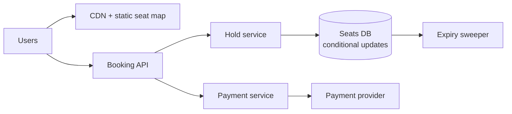

<p class="lead">Sell seats without ever selling one twice, while ten thousand people refresh the
same page at once. Correctness under a flash crowd.</p>

# Design a ticket booking service

## 1 · Requirements

**Functional**

- Browse events and seat maps.
- Hold seats while the user pays; release if they do not.
- Confirm the booking and issue a ticket.
- Cancel and refund.

**Non-functional**

- Never oversell a seat. This is the whole problem.
- Survive a flash crowd: 100× normal traffic at on-sale time.
- Browse must stay fast even when the write path is overloaded.
- Holds must expire, or inventory leaks.

## 2 · Estimates

| Quantity | Assumption | Result |
| --- | --- | --- |
| Browse | 10M users hitting one event page in a minute | ~170k QPS — CDN and static rendering mandatory |
| Bookings | 50k seats for a popular event | Bursty; the rate is irrelevant, the contention is not |
| Seat holds | 10-minute TTL | ~50k hold rows per event |
| Storage | 1M events × 10k seats | ~10 GB — trivial |

## 3 · API

```http
GET  /events/{id}/seats        -> 200 {seats[], version}
POST /holds                    {event_id, seat_ids[]} -> 201 {hold_id, expires_at}
DELETE /holds/{id}             -> 204
POST /bookings                 {hold_id, payment_method} -> 201 {booking_id, ticket}
GET  /bookings/{id}            -> 200 {status}
```

## 4 · Data model

| Table | Key | Notes |
| --- | --- | --- |
| `seats` | `event_id, seat_id` | status: available / held / sold, hold_id, version |
| `holds` | `hold_id` | event, seats, user, expires_at |
| `bookings` | `booking_id` | hold_id, payment_id, status |
| `payments` | `payment_id` | idempotency key, provider reference |

## 5 · High-level design



## 6 · Deep dives

### Preventing the double sell

The atomic primitive is a conditional update:

```sql
UPDATE seats
   SET status = 'held', hold_id = $1
 WHERE event_id = $2 AND seat_id = ANY($3) AND status = 'available';
```

If the number of affected rows equals the number of seats requested, the hold succeeded;
otherwise it failed and the user picks again. This is optimistic concurrency with the database as
the arbiter, and it needs no distributed lock.

The alternative — read the seat status, then write it — is a race and will oversell exactly when
the system is busiest.

### Surviving the flash crowd

Three separate problems.

**Read amplification.** The seat map is read by everyone and changes rarely. Render it statically
at the edge with a short TTL, and show a "last updated" timestamp. Do not query the database per
page view.

**Write contention.** Everyone wants the same popular seats. Serialising on the database is fine
because the transaction is microseconds; what must not happen is holding a transaction open while
the user pays. Hence the hold: it is a short transaction that reserves inventory, and payment
happens outside it.

**Queueing.** For a genuine flash sale, a virtual waiting room (a token bucket with a queue) is
kinder than thousands of failed holds. Users get a position and an estimate rather than an error.

### Holds must expire

A hold without expiry is leaked inventory: a user abandons checkout and the seat is unsellable
forever. Two mechanisms, both needed:

- A TTL on the hold row, swept every few seconds.
- A lazy check on read: a hold past its expiry is treated as available even before the sweeper
  runs.

Payment idempotency is the other half: the confirm call carries an idempotency key so a retried
payment cannot charge twice or create two bookings.

## 7 · Bottlenecks

| Symptom | Fix | Cost |
| --- | --- | --- |
| 170k QPS on browse | Static seat map at the edge | Up to a few seconds stale |
| Contention on hot seats | Short hold transactions, then pay outside | Holds can be abandoned |
| Payment provider limits | Queue with a per-provider rate limit | Added latency at confirm |
| Expired holds | Sweeper plus lazy expiry check | Two code paths for the same rule |

## 8 · Failure story

- The database is the arbiter of truth, so an application crash mid-hold leaves a row that expires
  rather than a seat that stays locked.
- A payment provider timeout is retried with the same idempotency key; the booking is created once.
- If the expiry sweeper dies, lazy expiry keeps inventory correct; the sweeper is an optimisation,
  not a correctness requirement.
- A refund cancels the booking and returns the seat to `available` in one transaction.

## Interview soundbite

> "Seats are held with a single conditional UPDATE — `WHERE status = 'available'` — and the row
> count tells me whether the hold succeeded, so overselling is impossible without any distributed
> lock. Payment happens outside that transaction, with a 10-minute hold TTL and an idempotency key
> on the confirm."

## Where to go next

- [ACID, BASE and transactions](../fundamentals/transactions.md)
- [Idempotency](../building-blocks/idempotency.md)
- [Too many requests → rate limit](../patterns/too-many-requests-rate-limit.md)
