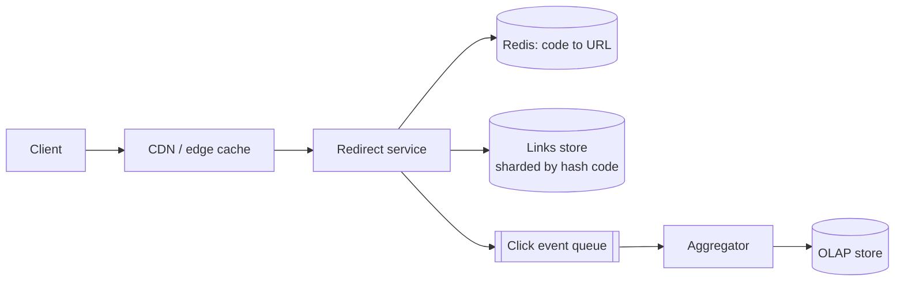

<p class="lead">A service that turns long URLs into short ones and redirects on lookup. Simple on
the surface; the interview is about key generation and read scale.</p>

# Design a URL shortener

## 1 · Requirements

**Functional**

- Create a short link from a long URL, with optional expiry and custom alias.
- Redirect a short code to the original URL.
- Basic analytics: click counts, not per-click events.

**Non-functional**

- Read-heavy: redirects outnumber creations by orders of magnitude.
- Redirect latency under 50 ms at p99, worldwide.
- Links are immutable once created; a deleted link returns 410.
- No collisions, ever — two links must never share a code.

**Out of scope** (say so out loud): auth internals, admin tooling, dashboards.

## 2 · Estimates

| Quantity | Assumption | Result |
| --- | --- | --- |
| Daily redirects | 100M per day | ~1,000 QPS average, ~3,000 at peak |
| Daily creations | 1M per day | ~12 QPS average |
| Record size | ~500 B (code, URL, owner, expiry) | ~500 MB per million links |
| Five-year storage | 1.8B links | ~1 TB — comfortably one sharded cluster |

## 3 · API

```http
POST   /links              {long_url, custom_alias?, expires_at?} -> 201 {code, short_url}
GET    /{code}             -> 302 Location: long_url
DELETE /links/{code}       -> 204
GET    /links/{code}/stats -> 200 {clicks, created_at}
```

## 4 · Data model

| Table | Key | Notes |
| --- | --- | --- |
| `links` | `code` | long_url, owner_id, created_at, expires_at, status |
| `links_by_owner` | `owner_id, created_at` | Secondary index for "my links" |
| `click_counts` | `code` | Approximate counter, flushed periodically |

## 5 · High-level design



## 6 · Deep dives

### Key generation

Three options, and the reasoning matters more than the choice.

**Hash the URL** (MD5, take seven characters). Deterministic, so the same URL yields the same
code — sometimes desirable, sometimes not. Collisions must be checked, and a check-then-insert
is a race.

**Counter plus base62.** 62⁷ is about 3.5 trillion codes in seven characters. A distributed
counter handing out blocks of ranges gives collision-free codes with no per-request
coordination — but sequential codes are enumerable, which is a privacy and scraping problem.

**Random seven characters with a uniqueness check.** Simple, non-enumerable, and the collision
probability is low enough to retry on, with a unique constraint making the retry safe.

I would use random codes with a unique constraint: the write path is only ~12 QPS, so a rare
collision retry costs nothing, and enumerability is avoided.

### The redirect path

The redirect is the hot path — 3,000 QPS at peak, and every millisecond shows up in a browser.
Cache the code→URL mapping in Redis; it is immutable, so there is no invalidation problem at
all. Put a CDN in front for genuinely hot links.

Use 302 when analytics matter, 301 when caching matters more. A 301 is cached by the browser, so
those clicks never reach your servers. Saying that trade-off out loud is the point of the deep
dive.

### Analytics without a write per click

A row-per-click design would put 100M writes a day into the same database serving redirects.
Instead, emit a click event to a queue and aggregate in a stream job, or increment a Redis
counter and flush deltas every 30 seconds. Counts become approximate, which is fine — say so.

## 7 · Bottlenecks

| Symptom | Fix | Cost |
| --- | --- | --- |
| Redirect QPS grows | Edge cache, Redis in front of the store | Cached links lose exact click counts |
| Store outgrows a node | Shard by `hash(code)` — lookups stay single-shard | Cross-shard listing needs an index |
| Analytics write load | Queue plus aggregation | Counts are eventually consistent |
| One viral link | CDN plus Redis | Stale counters at the edge |

## 8 · Failure story

- A Redis outage makes every redirect a database read. Acceptable at 3,000 QPS; above that,
  shed load rather than fall over.
- The analytics pipeline falling behind does not affect redirects — that separation is the
  point of the queue.
- A code collision is handled by the unique constraint and one retry, never by a
  check-then-write.
- Expired links return 410 rather than 404, so clients distinguish "gone" from "never existed".

## Interview soundbite

> "Random seven-character base62 codes with a unique constraint, so collisions are impossible
> rather than unlikely. Redis in front of the lookup because the mapping is immutable, and a 302
> rather than a 301 when analytics matter more than edge caching."

## Where to go next

- [Slow reads → cache](../patterns/slow-reads-cache.md)
- [Read-heavy DB → replicas](../patterns/read-heavy-replicas.md)
- [Unique ID generator](id-generator.md)
