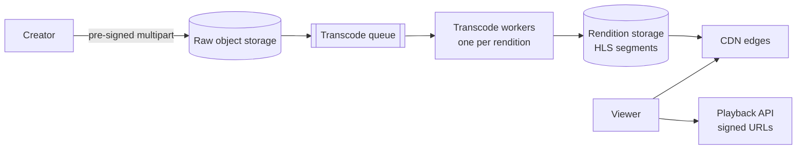

<p class="lead">Upload, transcode, store and stream video to millions of viewers. Almost entirely a
storage-and-bandwidth economics problem.</p>

# Design a video platform

## 1 · Requirements

**Functional**

- Upload a video; it becomes watchable within minutes.
- Stream with adaptive quality on variable networks.
- View counts and a simple recommendation list.
- Resume playback where the viewer left off.

**Non-functional**

- Under two seconds to first frame.
- Playback must not stall; adapt bitrate rather than buffer.
- Storage and egress dominate cost, so the design must minimise both.
- Uploads are durable before the user is told "uploaded".

## 2 · Estimates

| Quantity | Assumption | Result |
| --- | --- | --- |
| Uploads | 500 hours per minute | ~1 TB per hour at source quality |
| Renditions | 5 bitrates, ~1.5× source | ~1.5 PB per day of new storage |
| Views | 1B hours watched per day | Egress in PB per day — CDN only |
| Segments | 4 s each | ~750k segment requests per second at peak |

## 3 · API

```http
POST /videos               {title, size, content_type} -> 201 {video_id, upload_url}
PUT  {upload_url}          (direct to object storage, multipart)
POST /videos/{id}/complete -> 202 (transcoding queued)
GET  /videos/{id}/manifest -> 200 (HLS/DASH manifest, signed segment URLs)
POST /videos/{id}/progress {position_seconds} -> 204
```

## 4 · Data model

| Table | Key | Notes |
| --- | --- | --- |
| `videos` | `video_id` | owner, title, status, duration, renditions |
| `upload_sessions` | `video_id` | Multipart upload state, resumable |
| `view_events` | `video_id, ts` | Append-only, aggregated asynchronously |
| `watch_progress` | `user_id, video_id` | Resume position, 90-day TTL |

## 5 · High-level design



## 6 · Deep dives

### Transcoding is the expensive, spiky part

Two decisions.

**Queue everything and autoscale workers on queue depth.** Never transcode synchronously on
upload; the user would wait minutes.

**Transcode on demand for cold content.** Long-tail videos are rarely watched, so producing five
renditions for every upload wastes enormous compute. Produce a low rendition immediately and the
rest on first request, caching what has been done.

Priority queues matter: a creator with a large audience gets faster turnaround.

### Adaptive streaming and the segment model

Video is chunked into 2–10 second segments, each encoded at several bitrates, described by a
manifest (HLS or DASH). The player picks the next segment's bitrate from measured throughput and
buffer level.

This is what makes the CDN design work: segments are immutable, cacheable and independently
fetchable. A cache miss costs one segment, not the whole video. Popular content sits at the edge;
the long tail comes from origin.

### Storage and egress economics

Storage is the smaller number. Egress is the bigger one, which makes CDN peering a business
decision rather than a technical one. What reduces egress:

- Efficient codecs — a one-time compute cost for a permanent bandwidth saving.
- Aggressive edge caching for popular content.
- Regionally placed origin so CDN misses are cheap.
- Short-lived signed URLs so content cannot be hotlinked.

## 7 · Bottlenecks

| Symptom | Fix | Cost |
| --- | --- | --- |
| Transcode backlog after a viral upload | Priority queues, autoscale on depth | Cost during spikes |
| Egress cost | CDN with high hit ratio; modern codecs | Compute for re-encoding |
| Segment request rate | CDN absorbs it; origin sees only misses | Hit ratio is the whole ballgame |
| View count writes | Aggregate in a stream job | Counts are approximate |

## 8 · Failure story

- A transcode worker dying re-queues its job; transcoding is idempotent per rendition.
- The playback API being down does not stop playback for cached manifests — players continue from
  their buffer.
- A CDN edge outage is handled by DNS failover to a second provider, which is why large platforms
  multi-home.
- Losing a raw upload is unrecoverable, so uploads are durable in object storage before the user
  is told they succeeded.

## Interview soundbite

> "Uploads go straight to object storage with multipart pre-signed URLs, transcoding is a queued
> autoscaled pipeline with on-demand renditions for the long tail, and playback is HLS segments
> over a CDN — immutable segments mean a cache miss costs one segment, not a video."

## Where to go next

- [CDN](../building-blocks/cdn.md)
- [Object storage](../building-blocks/object-storage.md)
- [Slow files → object storage + CDN](../patterns/slow-files-object-storage-cdn.md)
