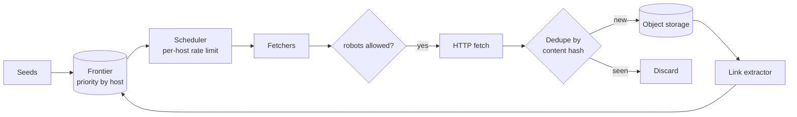

<p class="lead">Fetch the web politely, at scale, without fetching the same page twice or
hammering any single site.</p>

# Design a web crawler

## 1 · Requirements

**Functional**

- Given seed URLs, discover and fetch pages, following links to a configured depth.
- Store content and extracted links for downstream indexing.
- Respect `robots.txt` and per-host politeness limits.

**Non-functional**

- Politeness is a hard requirement: at most one request per second per host.
- Deduplicate: the same content must not be processed twice.
- Restartable: a crawl in progress survives a worker crash.
- Throughput around 1,000 pages per second across the fleet.

## 2 · Estimates

| Quantity | Assumption | Result |
| --- | --- | --- |
| Pages per month | 2.6 billion | ~1,000 pages per second |
| Page size | 100 KB HTML | ~260 TB per month — object storage mandatory |
| Frontier | 10⁹ pending URLs | ~100 GB of URL metadata |
| Dedup | 10¹⁰ content hashes | ~17 GB Bloom filter plus a persistent set |

## 3 · API

Internal rather than user-facing:

```text
enqueue(seed_urls)
GET /frontier/stats -> {pending, in_flight, done}
GET /pages/{id}     -> stored content reference
```

## 4 · Data model

| Table | Key | Notes |
| --- | --- | --- |
| `frontier` | `url_hash` | url, host, priority, next_allowed_at, state |
| `host_state` | `host` | robots rules, crawl delay, last_fetch_at, failures |
| `content_store` | `content_hash` | Pointer to object storage; the dedupe key |
| `seen_urls` | `url_hash` | Bloom filter in front of a persistent set |

## 5 · High-level design



## 6 · Deep dives

### The frontier is the design

The frontier is a priority queue of URLs plus per-host state. It must be persistent (a crash
resumes), partitionable (by host, so politeness is local), and schedulable (each host has a
`next_allowed_at`).

Partition by host hash, so one worker owns every URL for a host. Politeness then needs no
coordination — the worker sleeps until that host's next allowed time. That single decision
removes a distributed lock from the hot path.

### Deduplication at two levels

**URL level.** Normalise — lowercase the host, strip fragments and tracking parameters, sort
query parameters — then hash. Keep a Bloom filter in front of a persistent set. At a 10⁻⁴ false
positive rate the filter costs about 14 bits per URL, so 10¹⁰ URLs is roughly 17 GB of RAM,
which fits on a dedicated node.

**Content level.** Hash the extracted text rather than the raw HTML, so identical pages served
with different banners are recognised. This is what stops the infinite crawl of calendars and
session-ID links.

### Politeness versus throughput

One request per second per host across 100M hosts is not a throughput limit, it is a scheduling
problem. The scheduler picks whichever ready host has the highest priority.

Failure handling: exponential backoff per host on 5xx, blacklisting after N consecutive
failures, and a per-host page budget so a broken or infinite site cannot consume the fleet.

## 7 · Bottlenecks

| Symptom | Fix | Cost |
| --- | --- | --- |
| One host hammered | Host-partitioned workers with per-host rate limits | Slightly uneven throughput |
| Duplicate fetches | URL normalisation, Bloom filter, content hash | False positives drop a few pages |
| Frontier unbounded | Priority, recrawl scheduling, per-host budget | Some pages never fetched |
| Storage cost | Compressed HTML in object storage; text in the DB | Re-parsing needs a re-fetch |

## 8 · Failure story

- A worker crash loses in-flight URLs, which are re-queued after a visibility timeout. The crawl
  is at-least-once, and dedupe is what makes that safe.
- A site going down does not stall the crawl; its host state backs off while other hosts proceed.
- `robots.txt` changes are picked up on a 24-hour TTL rather than per request.
- A runaway crawl of one domain is capped by its page budget.

## Interview soundbite

> "The frontier is partitioned by host so one worker owns all URLs for a host — politeness then
> needs no distributed lock, just a sleep until that host is next allowed. Dedupe is a Bloom
> filter in front of a URL set, plus a content hash on the extracted text."

## Where to go next

- [Write spikes → queue](../patterns/write-spikes-queue.md)
- [Message queue](../building-blocks/message-queue.md)
- [Search index](../building-blocks/search-index.md)
