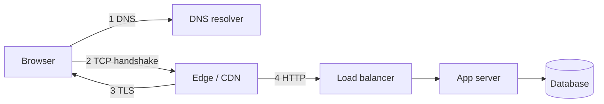

Most of your latency budget is spent in the network, and most of your
outages are network-adjacent. The parts worth knowing are small and specific.

# Networking for system design

## The path of one request

Each numbered step is a round trip, and each round trip is 0.5 ms in a datacenter and
150 ms across an ocean. **The single most useful optimisation in web systems is doing
fewer round trips.**

## DNS

- Resolves names to addresses; heavily cached at every layer with a TTL.
- **TTL is your failover lever and your failover delay.** A 5-minute TTL means a failover
  takes up to 5 minutes to reach clients.
- DNS-based load balancing is coarse: it distributes by resolver, not by request, and
  clients cache aggressively.
- GeoDNS routes users to the nearest region. Useful, and blunt — a user behind a
  misconfigured resolver gets the wrong continent.

## TCP, TLS, and why connection reuse matters

- A fresh TCP connection costs one round trip (three-way handshake), plus TLS 1.3's one
  round trip. On a 150 ms path, that is 300 ms before any data is sent.
- **Keep-alive** amortises that cost across requests. Connection pools do the same on the
  server side.
- **Head-of-line blocking**: HTTP/1.1 serialises requests on a connection, so browsers open
  six. HTTP/2 multiplexes streams, but a lost packet still blocks all streams on that TCP
  connection. HTTP/3 runs over QUIC/UDP to fix exactly that.
- **Timeouts are not optional.** A missing timeout is an unbounded resource leak: threads,
  connections, and memory held by a call that may never return.

## What each protocol is for

| Protocol | Use |
| --- | --- |
| HTTP/HTTPS | Request/response APIs, everything user-facing |
| WebSocket | Bidirectional, low-latency push (chat, live collaboration) |
| Server-sent events | One-way server push, simpler than WebSocket |
| gRPC (HTTP/2) | Service-to-service, typed, efficient, streaming |
| Long polling | Fallback where WebSocket is blocked |
| UDP / QUIC | Real-time media, games, HTTP/3 |
| AMQP / Kafka protocol | Messaging between services |

## The four network failures you must design for

1. **Latency spikes** — p99 network is far worse than p50. Timeouts and hedged requests
   handle this.
2. **Partial failure** — the request succeeded but the response was lost. The client cannot
   distinguish this from failure, which is exactly why writes need
   [idempotency keys](../building-blocks/idempotency.md).
3. **Connection exhaustion** — a slow dependency consumes the pool; new requests queue
   behind dead ones. Bulkheads and breakers.
4. **Asymmetric partitions** — A can reach B but B cannot reach A. Rare, and it defeats
   naive health checks.

## Practical defaults

- Timeout every outbound call; set it below the caller's timeout so errors propagate in
  order.
- Reuse connections; never open one per request.
- Compress responses over ~1 KB; it costs microseconds and saves milliseconds.
- Terminate TLS at the edge, not in every service.
- Keep payloads small; a 500 KB JSON response is a design smell.

## Interview soundbite

> "The client is in India and the primary is in us-east-1, so every uncached request pays
> about 200 ms. I'd put the read path in an Asia region with a replica there, keep writes
> going to the primary asynchronously, and serve media from a CDN edge — that takes the
> request path down to single-digit milliseconds."

## Where to go next

- [CDN](../building-blocks/cdn.md) — the network's answer to distance.
- [Load balancer](../building-blocks/load-balancer.md).
