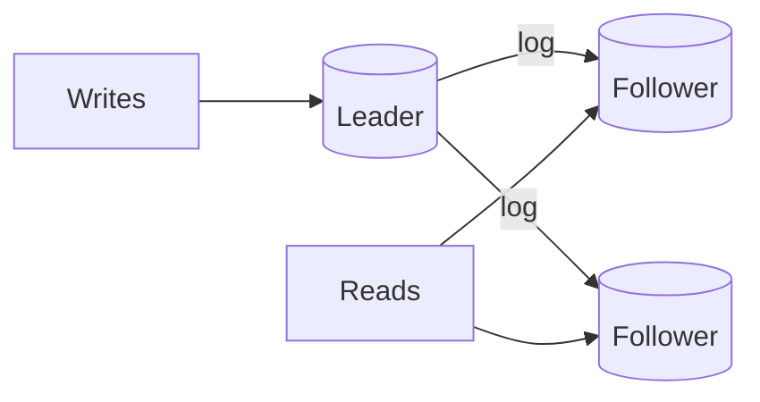

Two different things that get confused: replication copies data for
durability and read scale; partitioning splits it for write scale and size.

# Replication and partitioning

## Replication

Replication keeps multiple copies of the same data. It buys three things: read throughput,
durability, and availability during failure. It costs you consistency, because copies take
time to agree.

### Single-leader

All writes go to one leader; followers replay its log and serve reads.

- **Pros:** no write conflicts, simple to reason about, followers can take over.
- **Cons:** write throughput capped by one node; replication lag; failover is a decision
  (who is most caught up? what happens to the old leader's unshipped writes?).

### Multi-leader and leaderless

Multi-leader accepts writes in more than one place — good for multi-region writes, hard
because of conflicts. Leaderless (Dynamo-style) uses quorums: write to W of N replicas,
read from R of N, and if W + R > N you are guaranteed to read your own write. Cassandra
and DynamoDB are the familiar examples. Conflict resolution is by timestamp, vector clock,
or application logic — and "last write wins" is a data-loss strategy dressed as a policy.

### Replication lag, concretely

Asynchronous replication means a follower is behind by the time it takes to ship and
apply the log — single-digit milliseconds in a datacenter, seconds under load, and
unbounded if a follower falls over. Everything users complain about follows from that:

- Read-your-writes violations (see [consistency](consistency.md)).
- Monotonic-read violations when a client moves between replicas.
- Failover data loss equal to the lag at the moment of failure.

**Synchronous replication** removes the lag at the cost of adding the follower's round
trip to every write. A common compromise is *semi-synchronous*: wait for one follower to
acknowledge, let the rest catch up.

## Partitioning (sharding)

Partitioning splits the data set across nodes so each holds a slice. It is the only way to
scale writes and the only way to exceed one machine's storage.

| Strategy | How | Good | Bad |
| --- | --- | --- | --- |
| **Range** | Key ranges per partition (`a–f`, `g–m`) | Efficient range scans; ordered reads | Hot spots on sequential keys (timestamps, auto-increment) |
| **Hash** | `hash(key) mod N` | Even distribution | Range scans become scatter-gather |
| **Consistent hashing** | Key and nodes on a ring; key belongs to next node clockwise | Adding a node moves only 1/N of keys | Needs virtual nodes for balance |
| **Directory / lookup** | A service maps key → partition | Flexible, easy rebalancing | The directory is a dependency and a bottleneck |

### Choosing a shard key

The key decides everything downstream. Ask, in order:

1. **Does the dominant query include this key?** If not, every query becomes a scatter-gather.
2. **Is it evenly distributed?** A celebrity user or a giant tenant creates a hot shard.
3. **Is it stable?** Re-keying data later means a migration with downtime risk.
4. **Does it group related rows?** `tenant_id` keeps a customer's data co-located, so their
   transactions stay single-shard.

Common answers: `user_id` for social data, `tenant_id` for B2B SaaS, `conversation_id` for
chat, `hash(short_code)` for a URL shortener. Avoid `created_at` as the primary shard key —
it makes every recent write land on the same partition.

### The consequences you must accept

- Cross-shard joins move into the application or into a separate analytical store.
- Cross-shard transactions become sagas or are avoided by choosing a key that keeps them
  local.
- Aggregates (`COUNT(*)`, sums) require scatter-gather or precomputation.
- Rebalancing needs a plan: consistent hashing, logical shards mapped to physical nodes, or
  a directory service.
- Secondary indexes are either local (per-shard, so queries fan out) or global (maintained
  asynchronously).

!!! tip "The cheapest rebalancing trick"
    Use many more logical shards than physical nodes — say 1,024 logical shards across 16
    nodes — and map logical to physical in a small lookup table. Moving a node becomes a
    metadata change, not a data rewrite.

## Interview soundbite

> "Replication gives me read scale and durability; partitioning gives me write scale. I'd
> replicate first, because it is reversible, and shard by `user_id` only if write volume or
> storage genuinely exceeds one node — accepting that cross-user queries then become
> scatter-gather."

## Where to go next

- [Read replicas](../building-blocks/read-replicas.md) and [sharding](../building-blocks/sharding.md) — the operational versions.
- [Consistent hashing](../code/consistent-hashing.md) — a working implementation.
