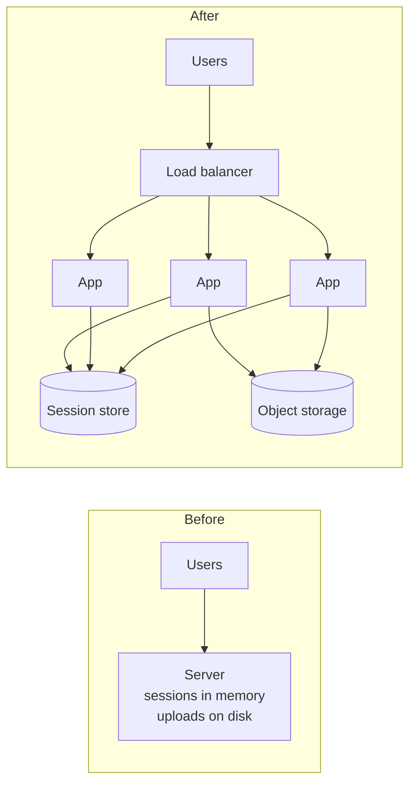

Scaling is not "add servers". It is removing the reasons a second
server cannot help.

# Scalability

## What it is

A system scales if adding resources produces a roughly proportional increase in capacity.
Two kinds:

- **Vertical (scale up):** a bigger machine — more cores, more RAM, faster disks. Simple,
  no code change, and it stops dead at the largest machine you can buy.
- **Horizontal (scale out):** more machines. Effectively unlimited, and it requires the
  system to be *partitionable* — no request may depend on state held in one specific
  process's memory.

The real work of scaling is almost never adding machines. It is removing the state that
makes the second machine useless.

## The three states that block horizontal scaling

| State | Why it blocks scaling | The fix |
| --- | --- | --- |
| Session in process memory | The next request lands on a different server and the user is logged out. | Move sessions to a shared store or a signed cookie. |
| Local filesystem writes | Files written on server A are invisible on server B. | Object storage. |
| In-process cache that is authoritative | Two servers disagree about the truth. | Shared cache, or make the database authoritative. |

Once those three are gone, the application tier is *stateless*, and a load balancer can
send any request to any instance.

## Amdahl's law, informally

If 10% of the work must happen in one place — a single primary database, a lock, a
sequence generator — then no amount of extra app servers gets you past a 10× improvement
on that path. When a system "does not scale", the cause is almost always that someone
found the 10%.

Practical consequence: **scale the tier that is actually the constraint.** Adding app
servers to a system bottlenecked on one database is expensive theatre.

## Read scaling versus write scaling

These are different problems with different answers, and conflating them is the most
common estimation error in interviews.

- **Reads** scale by duplication: caches, read replicas, CDNs. Duplicating a read is
  harmless because nothing changes.
- **Writes** scale by partitioning: sharding, queues, batching. Duplicating a write is a
  correctness bug, so writes must be split rather than copied.

That asymmetry is why [read replicas](../building-blocks/read-replicas.md) are cheap and
[sharding](../building-blocks/sharding.md) is expensive.

## When to reach for it

- Scale up first when the constraint is a database and the workload is not yet
  partitionable. A larger primary is often cheaper than a six-month sharding project.
- Scale out when the app tier is the constraint, or when you need redundancy anyway — at
  which point statelessness pays for itself twice.

!!! warning "The order that avoids pain"
    Index and cache before replicating. Replicate before sharding. Shard only when data
    size or write volume genuinely exceeds one node. Each step costs an order of magnitude
    more operational complexity than the last.

## Interview soundbite

> "I'd make the app tier stateless — sessions in Redis, uploads in object storage — so
> that horizontal scaling and rolling deploys both become possible. The database is the
> real constraint at 2,000 write QPS, so I'd tune and index it before considering
> replicas or sharding."

## Where to go next

- [Latency and throughput](latency-and-throughput.md) — why more capacity does not always
  mean faster responses.
- [Replication and partitioning](replication-and-partitioning.md) — the mechanics of
  scaling data.
