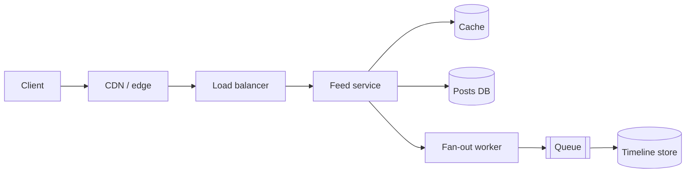

<p class="lead">Six steps, in order, with a time budget and the sentence that opens
each one. Use this until it becomes habit.</p>

# A framework for answering

The framework exists to stop you from doing the two things that lose interviews:
designing before scoping, and designing everything at once.

## Step 1 — Scope the problem (3–5 min)

Restate the problem in one sentence, then cut it down.

> "So this is a service where users post short text and follow each other, and the hard
> part is assembling a feed cheaply. I'll assume posting, following and reading the feed,
> and I'll leave out ads, moderation and analytics — tell me if any of those are the
> point."

Two or three clarifying questions follow, each tied to a design decision:

- "Read-to-write ratio — is this a feed everyone reads or a tool a few people write to?"
- "How fresh does the feed have to be? Seconds or minutes?"
- "Mobile clients on poor networks, or desktop?"

## Step 2 — Put numbers on it (3–5 min)

Derive peak QPS, storage per year, and a latency target. Show the arithmetic. See
[estimation drills](estimation.md) for the method.

> "10 million daily users, each reading the feed twenty times and posting twice, so 200M
> reads and 20M writes a day. Average is about 2,300 read QPS; peak at three times
> average is roughly 7,000. A post is a kilobyte, so 20M a day is 20 GB a day, about
> 7 TB a year."

That paragraph decides half the design. 7,000 read QPS with 200 GB of hot data is a
cache-and-replicas problem, not a sharding problem.

## Step 3 — Sketch the interface (3–5 min)

The handful of calls that matter, with shapes. This is where pagination, idempotency and
versioning surface naturally.

```http
POST /posts            {text} -> {post_id, created_at}
GET  /feed?cursor=...        -> {items[], next_cursor}
POST /follows/{user_id}      -> 204
```

Say why cursor pagination rather than offset: offsets get slower and skip items when the
underlying set changes.

## Step 4 — Data model and storage choice (3–5 min)

Access patterns first, then the store. Name the reason, not the product.

> "The dominant query is 'posts by these 500 followees, newest first, limit 20'. That is
> a range scan on a composite key of author and timestamp, so a wide-column or key-value
> store with that key works, and a relational table with a covering index works too. I'd
> start relational, because the write volume is fine and transactions help."

## Step 5 — Draw the happy path (10–15 min)

One diagram: client, edge, load balancer, services, caches, queues, stores. Then narrate
one request as it travels. Do not draw the failure cases yet.



## Step 6 — Walk the bottleneck and failure story (10 min)

Now use the twelve patterns as a checklist, in this order:

1. **Reads slow?** Cache, then replicas.
2. **Writes spiking?** Queue, then shard.
3. **Entry overloaded?** Load balancer, then rate limit.
4. **Queries slow?** Index before anything else.
5. **Big files?** Object storage plus CDN.
6. **Dependencies flaky?** Retry, breaker, idempotency.
7. **Blind?** Logs, metrics, traces, and the alert that would page someone.

Each answer is one or two sentences, and each ends with its cost. That rhythm — fix,
then price — is the single most reliable signal of seniority in the room.

## The closing move

Reserve the last minute for what you would do first in production:

> "If I shipped this tomorrow, I'd watch feed assembly p95, cache hit rate, and fan-out
> queue age. The first thing I'd expect to break is the fan-out for a user with a million
> followers, so I'd add a write-limit and a pull path for high-fan-out accounts before
> launch."

That sentence demonstrates you have thought past the diagram, which is precisely what
the rubric row called *failure modes* is looking for.
