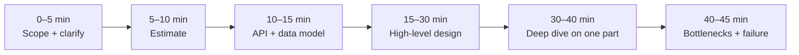

What a design interview is really measuring, how the forty-five
minutes usually break down, and the specific behaviours that separate a pass from a
strong pass.

# Anatomy of the interview

## What is being scored

Interviewers are usually filling in a rubric with four or five rows. The exact wording
varies, but the rows are remarkably stable:

| Dimension | What "strong" looks like | What sinks you |
| --- | --- | --- |
| **Problem navigation** | You drive. You scope, prioritise, and say what you are deferring. | Waiting to be led; designing every feature at once. |
| **Technical depth** | You know how the component works, not just its name. | Hand-waving "Kafka handles that". |
| **Trade-off reasoning** | Every choice has a stated cost and an alternative you rejected. | Listing technologies without justification. |
| **Quantitative reasoning** | Numbers appear early and get used later. | Estimates only when asked, then abandoned. |
| **Communication** | The diagram matches the words; the interviewer can follow without interrupting. | Silent typing, unreadable boxes, no narrative. |

Notice that three of the five rows are about reasoning, not recall. This is why
memorising patterns is not enough — and why a candidate who knows fewer components but
reasons well usually wins.

## The forty-five minutes, roughly

Two things go wrong here most often. First, spending fifteen minutes on requirements,
which reads as stalling. Five minutes and three or four questions is enough. Second,
skipping the estimate, which makes every later decision unfalsifiable.

## The four questions to ask first

Ask only what changes the design. In practice:

1. **Who uses it, and how much?** Daily active users and the read-to-write ratio.
2. **What are the core flows?** Two or three, named explicitly — "post, follow, read
   feed".
3. **What can we leave out?** Authentication, analytics, admin tooling, and payments are
   almost always deferrable, and saying so buys you time.
4. **What does "good" mean?** A latency target and a consistency requirement. "Feed
   visible within five seconds is fine" is worth more than any diagram.

!!! tip "Write the assumptions on the board"
    Put the numbers in a corner of the whiteboard and refer to them later. An interviewer
    who sees you consult your own estimate knows the estimate was real.

## Levels, in practice

A junior candidate is expected to produce a working diagram and name the right
components. A mid-level candidate is expected to justify choices and handle one deep
dive. A senior candidate is expected to lead the conversation, quantify, and volunteer
failure modes before being asked — and to say what they would measure in production.

The difference between mid and senior is rarely more knowledge. It is usually that the
senior candidate brings up the second-order consequences unprompted: replication lag,
retry storms, hot shards, cache stampedes, and what the on-call engineer sees at 3 a.m.
