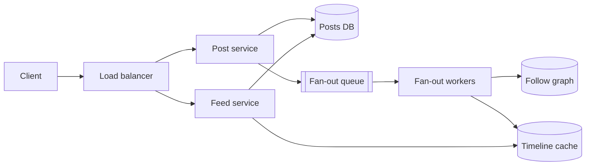

<p class="lead">A complete forty-five-minute answer, written as a script with annotations in
the margin. Read it aloud once; it is longer than you think.</p>

# Mock walkthrough

**The prompt:** "Design a system where users can post short text updates and follow each other,
and see a feed of posts from people they follow."

## Minute 0–3 · Scope

> "Let me restate it: a posting service plus a follow graph plus a feed. The feed is the
> interesting part, so I'll assume posting is simple text, following is asymmetric, and reading the
> feed is the hot path. I'll leave out DMs, search, ads and moderation — tell me if any of those is
> actually the point."

!!! note "Why this works"
    Restating in one sentence proves you understood it. Naming what is out of scope buys you time
    and shows judgement. Inviting the interviewer to redirect makes it collaborative.

Two questions follow:

> "Roughly how many daily users, and is the feed read far more than it's written?"

> "How fresh does the feed have to be — if a post appears five seconds late, does anyone care?"

## Minute 3–8 · Estimate

> "Say 10 million daily users. Each reads the feed 20 times and posts twice, so 200 million reads
> and 20 million writes a day. Divide by 10⁵ seconds: about 2,000 read QPS average, 6,000 at peak.
> Writes are about 200 a second, 600 at peak.
>
> A post is 1 KB, so 20 GB a day, about 7 TB a year with indexes. Average followers, say 200 — so a
> post is 200 timeline writes, and 600 posts a second at peak is 120,000 timeline writes per
> second."

!!! note "Why this works"
    The last sentence is the one that matters. It converts a posting rate into a fan-out rate,
    which is the actual bottleneck. That derivation is the difference between a candidate who has
    read about feeds and one who has thought about them.

## Minute 8–12 · API and data model

```http
POST /posts            {text} -> 201 {post_id}
GET  /feed?cursor=     -> 200 {items[], next_cursor}
POST /follows/{id}     -> 204
```

> "Cursor pagination on `(created_at, post_id)`, not offset — offsets get slower with depth and
> skip items when new posts arrive, which here is constantly.
>
> Tables: `posts` keyed by a time-sortable post ID; `follows` with both directions indexed;
> `timelines` as a precomputed per-user list capped at about 800 entries; and approximate counters
> for likes."

## Minute 12–22 · High-level design



> "Posting writes the row and enqueues a fan-out job, so the writer never waits for 200 timeline
> writes. The feed read is a single cache lookup against the precomputed timeline; on a miss it
> falls back to pulling posts from the followees' recent posts."

## Minute 22–32 · Deep dive: the fan-out

> "Push-on-write makes reads one cache lookup, which is why feeds feel instant. The problem is a
> user with 10 million followers: one post becomes 10 million writes, which at 100k writes a second
> is 100 seconds of backlog behind a single event.
>
> So: hybrid. Push for ordinary users — under, say, 100k followers. For high-fan-out accounts,
> don't push at all; mark them pull-only, and merge their recent posts at read time. The read path
> pays slightly more for those users, and the write path stops having cliffs.
>
> The timeline cache is about 5 TB for 50 million users at 500 entries each — that's the expensive
> number, so entries are capped and cold users are evicted to a wide-column store."

## Minute 32–40 · Bottlenecks and failure

| Symptom | Response | Cost |
| --- | --- | --- |
| Read QPS 6k peak | Sharded Redis timelines | Cost |
| Fan-out backlog | Alert on queue age; autoscale workers | Eventual feed freshness |
| Follow graph queries | Cache follower lists | Unfollow propagates slowly |
| Deep pagination | Cap timeline; fall back to the DB | Older pages slower |

> "Failure cases: if the timeline cache loses a shard, those users fall back to a pull — slower but
> correct. If the fan-out queue backs up, feeds are stale by seconds, which the product already
> tolerates, and I alert on queue age rather than depth. A deleted post is filtered on read and
> purged in the background."

## Minute 40–45 · What I would ship and measure

> "First version: single relational database with the composite index for the feed query, Redis
> timelines, and fan-out workers. No sharding, because 7 TB and 600 write QPS is well within one
> primary.
>
> I'd watch feed-assembly p95, timeline cache hit rate, and fan-out queue age. I'd expect the first
> thing to break to be a high-fan-out account, which is why the pull path ships in version one
> rather than later."

!!! tip "The close"
    Ending on "what I would ship first and what I expect to break" is the strongest possible last
    impression. It demonstrates prioritisation, operational thinking, and self-awareness at once.

## What the interviewer wrote down

- Scoped in three minutes and named the out-of-scope items.
- Estimated without prompting, and converted writes to fan-out rate — the key insight.
- Chose hybrid fan-out, and justified it with a number.
- Volunteered the celebrity problem before being asked.
- Ended with monitoring and a first-shippable version.
- Weakness: did not discuss ranking at all; the interviewer had to ask.

That last line is what practice is for. Read the transcript again and find yours.
