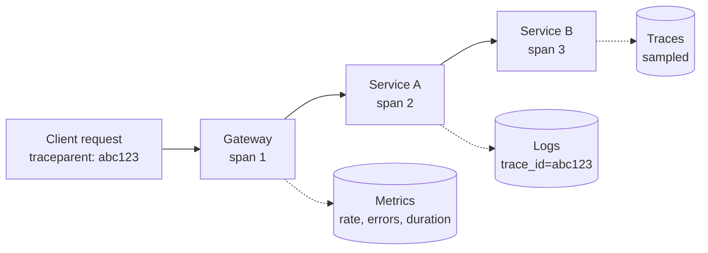

You find out about incidents from users. Three signals fix that: metrics tell you something is wrong, traces tell you where, logs tell you what happened to one request.

# 12 · Can't see what broke → logs, metrics, tracing

## What the symptom looks like

- The first report of an outage is a customer message.
- You cannot answer "is it slow for everyone or just this user?"
- Debugging means adding print statements and redeploying.
- You know the p99 is bad but not which of the twelve services is responsible.

## The mechanism

Instrument at the boundaries: every inbound request, every outbound call, every state
transition. Propagate a trace ID (W3C `traceparent`) through everything, so one identifier links a
log line, a span, and the metric spike it belongs to.

Metrics are aggregated and cheap to query but cannot be sliced by a high-cardinality value;
traces are per-request and sampled; logs are verbose and expensive. Use each for what it is
good at, and never label a metric with a user ID.

## When to reach for it

- Always, once more than one service is involved in a request.
- When "it is slow" is the entire bug report.
- Before an incident, because you cannot retrofit correlation IDs into an outage.

!!! warning "When it is the wrong move"
    Never — but scope the cost. Sample traces, bound metric cardinality, and set log retention deliberately.

## Trade-offs

**Cost.** Observability often costs more than the compute it observes. Sampling and retention are design decisions.

**Cardinality.** A metric labelled with user ID creates a series per user and a bill to match. Keep labels bounded.

**Instrumentation effort.** Every new service must be wired in. Make it a template, not a task someone remembers.

**Alert fatigue.** Alerting on CPU trains people to ignore alerts. Alert on symptoms users feel — SLO burn rate.

## Failure modes

| Failure | What you see | Fix |
| --- | --- | --- |
| No correlation ID | Logs from different services cannot be joined | Propagate `traceparent` from the edge |
| High-cardinality labels | Metrics bill explodes | Bound label values; use traces for per-request detail |
| Debug log in a hot loop | Log volume 100×, and a surprise bill | Sampling and level control per route |
| Paging on causes | "Disk 70% full" at 3 a.m. | Page on error-budget burn; ticket on causes |

## Sizing it

Four dashboards cover most systems: request rate, error rate, latency percentiles, and
saturation. Four alerts cover most incidents: SLO burn rate, queue age, replica lag, and
connection pool exhaustion.

## Interview soundbite

> "Every request carries a W3C trace ID into logs, metrics and spans, so one ID takes me from the dashboard to the slow span. I page on SLO burn rate rather than CPU, and I keep queue age and replica lag on the dashboard because those predict user pain before it lands."

## Where to go next

- [Observability](../building-blocks/observability.md)
- [Metrics pipeline case study](../case-studies/metrics-pipeline.md)
- [Availability and reliability](../fundamentals/availability.md)
