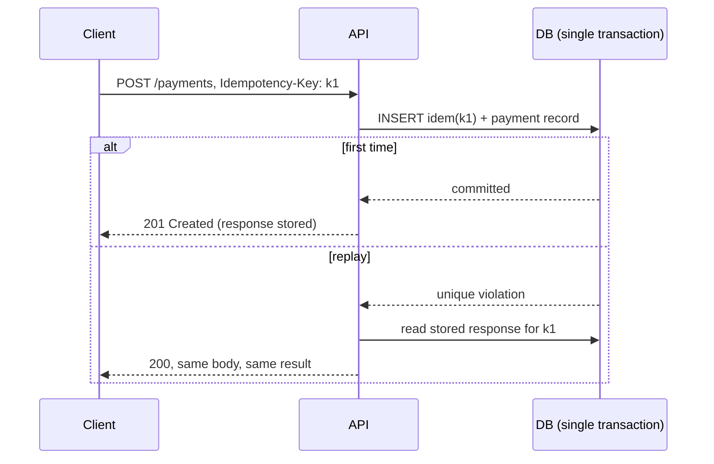

Retries, redeliveries and double-clicks all produce the same request twice. An idempotency key makes the second one return the first one's result instead of repeating its effect.

# 11 · Duplicate requests → idempotency keys

## What the symptom looks like

- A user is charged twice after a timeout and a retry.
- A queue consumer creates two records from one message.
- A double-click creates two orders.
- Webhook handlers process the same event several times.

## The mechanism

The client generates a key per logical operation and sends it as a header. The server
inserts the key into a unique-constrained table **in the same transaction** as the business
write. The first request wins; a replay hits the constraint and returns the stored response with
the original status.

The atomicity is the whole point. A read-then-write check races, and it races exactly when it
matters — under concurrent duplicates.

## When to reach for it

- Any write with a side effect that a client or a queue might repeat.
- Payment, order, booking, provisioning — anything where a duplicate is expensive or visible.
- Webhook receivers and queue consumers, which are at-least-once by nature.

!!! warning "When it is the wrong move"
    The operation is naturally idempotent already — a `SET`, a conditional update, an upsert. Use that instead of a key store.
    Reads. There is nothing to duplicate.

## Trade-offs

**A store to operate.** The key table sits on the write path of your most important endpoint, so it must be as reliable as the data it protects.

**Atomicity across systems.** If the key store and the business database are separate, you have a distributed transaction again. Keep them in one database.

**Retention policy.** Too short and a late retry duplicates; too long and the table grows without bound. Hours to days is typical.

**It cannot dedupe different requests.** Two genuine orders with identical contents are two orders. Only the client knows the difference, which is why the key comes from the client.

## Failure modes

| Failure | What you see | Fix |
| --- | --- | --- |
| Read-then-write race | Two concurrent duplicates both process | Unique constraint, not a select-then-insert |
| Server-generated key | Always unique, therefore useless | Client supplies the key |
| Key stored, response not | Replay returns a different body | Store the response body and status |
| Key deleted on success | The next retry reprocesses | Keep until TTL expiry |

## Sizing it

A key table with a unique index on `(scope, key)` and a TTL of 24 hours costs one extra
insert per write. That is cheaper than a single duplicate payment, which is the entire
justification.

## Interview soundbite

> "The client sends an Idempotency-Key; I insert it in the same transaction as the payment, so the first request wins and any replay hits the unique constraint and gets the stored response back. Keys expire after 24 hours."

## Where to go next

- [Idempotency](../building-blocks/idempotency.md)
- [Idempotency store code](../code/idempotency.md)
- [Delivery semantics](../fundamentals/delivery-semantics.md)
