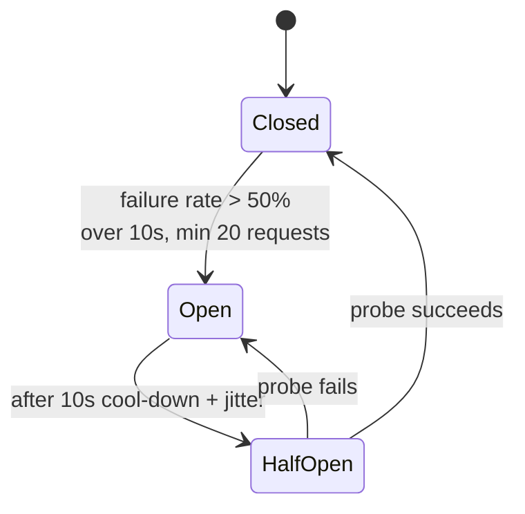

A failing dependency does not just return errors — it consumes your threads while they wait. A breaker stops calling it, fails fast, and probes carefully to recover.

# 10 · One service failing → circuit breaker

## What the symptom looks like

- Your service is slow or down because a dependency is slow, not because it is busy.
- Thread pools or connection pools are exhausted by calls to one dependency.
- Error rates spike after a downstream incident and stay high after it recovers.

## The mechanism

A three-state machine: **closed** (calls pass, failures counted), **open** (calls fail
immediately without touching the dependency), **half-open** (a few probes allowed). It opens when
the failure rate in a rolling window exceeds a threshold with a minimum volume, and closes when
probes succeed.

The essential partner is a **fallback**. A breaker without one just relocates the error.

## When to reach for it

- Any synchronous call to another service or a third party.
- The dependency has a meaningful failure rate and you can define a degraded response.
- Waiting on it is expensive — long timeouts, scarce threads.

!!! warning "When it is the wrong move"
    The call must succeed or the whole operation is pointless (payment authorisation). You need an honest error, not a fallback.
    The dependency is local and fast; a timeout is enough.

## Trade-offs

**False opens.** A brief blip cuts off a healthy dependency. Require a minimum request volume and a sensible window.

**Recovery is delicate.** Too many half-open probes can re-kill a recovering service. Probe one request, then ramp.

**State is per instance.** Ten instances open at different times. Acceptable; centralised state usually costs more than it saves.

**It hides problems.** A breaker open for a week means a feature has been dead for a week. Alert on open state.

## Failure modes

| Failure | What you see | Fix |
| --- | --- | --- |
| Breaker without timeout | The closed state still hangs | Always pair with a timeout below the caller's |
| Counting client errors | A burst of 400s opens the circuit for a healthy service | Count only timeouts, 5xx, connection errors |
| No jitter on cool-down | All instances probe simultaneously and re-trip it | Jitter the open duration |
| Silent fallback | Users see stale data for days | Emit a metric when the fallback is used; alert on sustained use |

## Sizing it

A 10-second rolling window with a 50% failure threshold and a minimum of 20 requests
avoids opening on noise. Cool-down of 5–30 seconds with jitter, one to five probe requests. Tune
from real latency data, not from a default in a library.

## Interview soundbite

> "Per-dependency breaker with a 10-second window and a 50% threshold, a cached fallback for recommendations, and a single half-open probe with jitter. I alert if it stays open more than five minutes, because that means a feature is silently dead."

## Where to go next

- [Circuit breaker](../building-blocks/circuit-breaker.md)
- [Circuit breaker code](../code/circuit-breaker.md)
- [Availability and reliability](../fundamentals/availability.md)
