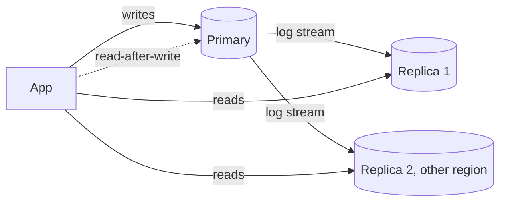

Reads exceed what one primary can serve. Copies of the data, kept in sync by log shipping, take the read load and double as failover targets.

# 04 · Read-heavy database → add read replicas

## What the symptom looks like

- Read QPS is an order of magnitude above write QPS.
- The primary is CPU-bound on read queries while writes are modest.
- Read queries are varied, so a cache would miss often.
- You need a failover target anyway, for availability.

## The mechanism

The primary applies writes and streams its change log to followers. Followers apply the
log and serve reads. Lag is the time between a write committing on the primary and appearing on
a follower — single-digit milliseconds in a datacenter, seconds under load.

Every user-visible problem with replicas comes from lag, and every fix is about routing: send
reads that must be fresh to the primary, and everything else to a follower.

## When to reach for it

- Read-heavy and the queries are broad rather than a few hot keys.
- Writes comfortably fit on one primary, so write scale is not the problem.
- You want a hot standby for failover, or an analytics target that does not disturb production.

!!! warning "When it is the wrong move"
    Writes are the bottleneck — replicas do nothing for write throughput.
    The reads are a handful of hot records; a cache is cheaper and faster.
    You cannot tolerate any staleness and cannot route around it, which is rare but real for balances.

## Trade-offs

**Staleness.** Reads may not reflect the latest write, which is a user-visible bug ("my comment vanished"). Handled with read-your-writes routing.

**Writes remain single-node.** Replicas buy read scale only. If write QPS is the constraint, you need batching, a queue, or sharding.

**Failover is a decision.** Promotion loses the unshipped log, and the old primary must be fenced or you get split-brain. RPO equals lag at the moment of failure.

**Cost and surface.** Each replica is a full copy: backups, upgrades, monitoring, and a workload that can itself cause lag.

## Failure modes

| Failure | What you see | Fix |
| --- | --- | --- |
| Lag spikes during bulk writes | Nightly jobs make every replica minutes behind; users see old data at 2 a.m. | Throttle bulk writes or run them against a dedicated replica |
| Read inside a transaction routed to a replica | Broken atomicity; inconsistent reads within one transaction | Route transaction reads to the primary |
| Replica of a replica | Lag amplifies with depth | Keep replication one level deep |
| Replica cannot catch up | Apply lag grows without bound | Remove long queries from the replica; check its indexes |

## Sizing it

Replication factor 2–3 in a region is normal; a cross-region replica adds 100–200 ms of
lag, which is fine for analytics and too much for read-your-writes. Alarm on lag above one or
two seconds, because that is where the routing window stops being safe.

## Interview soundbite

> "Reads go to replicas; any read inside a transaction, or immediately after a user writes, goes to the primary. I alarm on replica lag above two seconds because that is where read-your-writes routing stops being safe."

## Where to go next

- [Read replicas](../building-blocks/read-replicas.md)
- [Replication and partitioning](../fundamentals/replication-and-partitioning.md)
- [Consistency models](../fundamentals/consistency.md)
