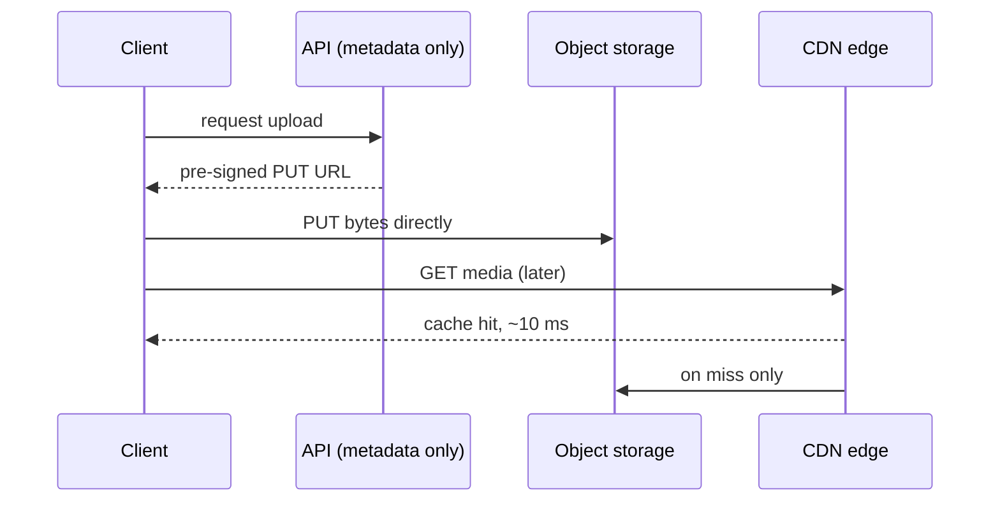

Bytes are being streamed through application servers or stored in a database. Move them to object storage, put a CDN in front, and the problem disappears along with most of the egress bill.

# 07 · Slow file loads → object storage + CDN

## What the symptom looks like

- Images or downloads take seconds while the HTML loads instantly.
- App server memory or bandwidth spikes when media is requested.
- The database is huge and slow, and most of the size is blobs.
- Users far from your region see dramatically worse media performance.

## The mechanism

Two moves, in order. First, move the bytes out of the request path: store them in object
storage, and have clients upload directly via a pre-signed URL. Your service handles metadata
only. Second, serve them from a CDN edge near the user, with immutable content-hashed URLs so
caching is simple and invalidation is unnecessary.

## When to reach for it

- Any binary larger than a few kilobytes is being served by application code.
- The audience is geographically spread.
- Files are immutable or versioned, so caching is easy.

!!! warning "When it is the wrong move"
    Content must never leave your infrastructure for regulatory reasons — then you need an internal CDN or edge, not a public one.
    Files are tiny and infrequent; the complexity is not worth it.

## Trade-offs

**Invalidation is slow and partial.** Design for immutable, content-hashed URLs rather than purging mutable ones.

**You no longer control the edge.** Debugging means reasoning about someone else's cache. Insist on `X-Cache` headers and a bypass.

**Cost model changes.** Egress per GB is cheap at scale and a nasty surprise during a cache-miss storm.

**Object storage latency.** Tens of milliseconds per request — never one read per row in a loop.

## Failure modes

| Failure | What you see | Fix |
| --- | --- | --- |
| Personalised response cached publicly | One user's private file served to thousands | `Cache-Control: private`; `Vary` on the right headers |
| Public bucket | The most common cloud data leak | Block public access at the account level; audit policies |
| Long-lived signed URL | A leaked link is a leaked file | Five-minute TTLs for private objects |
| Orphaned objects | Storage grows forever after DB rows are deleted | Lifecycle policies and periodic reconciliation |

## Sizing it

A CDN hit is roughly 5–30 ms; an origin fetch across an ocean is 150–250 ms. The
saving is per request, so it scales with traffic — and the origin egress drops by the hit rate,
typically 90–99% for media.

## Interview soundbite

> "Media lives in object storage, uploaded directly with a pre-signed URL so bytes never touch our servers, and served through a CDN with content-hashed URLs and a one-year TTL, so we never purge."

## Where to go next

- [CDN](../building-blocks/cdn.md)
- [Object storage](../building-blocks/object-storage.md)
- [Video platform case study](../case-studies/video-platform.md)
