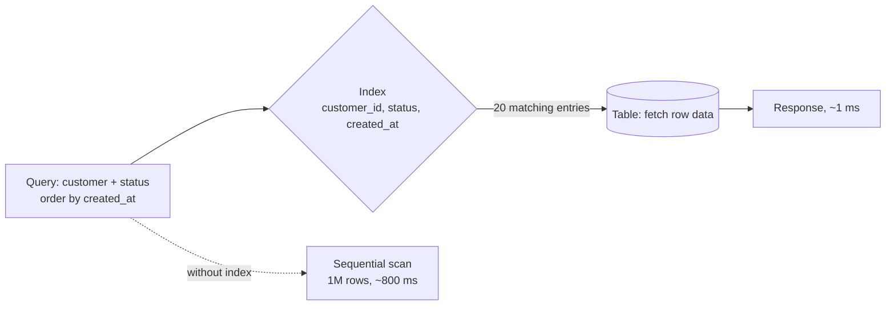

A query is scanning rows it does not need. An index turns that scan into a seek, and it is the cheapest fix in this entire guide.

# 06 · Slow queries → add indexes

## What the symptom looks like

- One endpoint is slow while others are fine.
- `EXPLAIN` shows a sequential scan, a filesort, or a nested loop over a large set.
- Latency grows linearly with table size — the signature of a scan.
- The rows-examined to rows-returned ratio is enormous.

## The mechanism

A B-tree index keeps values sorted with pointers to rows, so equality, range and
ordering can be answered by walking the tree rather than the table. For a composite index the
column order is the whole game: equality columns first, then the sort column, so `LIMIT 20`
reads twenty entries instead of sorting a million rows.

For "my orders, newest first, filtered by status", the index is
`(customer_id, status, created_at DESC)`.

## When to reach for it

- A query filters or sorts on unindexed columns and the table is large.
- The dominant access pattern is known and stable, so an index will be used.
- You have confirmed with `EXPLAIN` that the planner will choose it.

!!! warning "When it is the wrong move"
    The table is tiny. A scan of 500 rows is faster than the planner overhead.
    The column has two values and one covers 95% of rows — the planner will ignore the index.
    The table is write-hot and already over-indexed; you will trade a read problem for a write problem.

## Trade-offs

**Write amplification.** Every insert and update maintains every index. Ten indexes make writes substantially more expensive and consume cache.

**Storage.** Often 20–50% of table size, more for wide composite indexes.

**The planner may ignore it.** Low selectivity, stale statistics or an implicit cast all produce a scan anyway. Always re-check `EXPLAIN`.

**Migration pain.** More indexes make bulk loads and schema changes slower, which is where teams discover them.

## Failure modes

| Failure | What you see | Fix |
| --- | --- | --- |
| Function on an indexed column | `WHERE lower(email) = ?` never uses the plain index | Index the expression, or store a normalised column |
| Implicit cast | Comparing a varchar column to a number | Fix the types in the query |
| Wrong column order | A composite index exists but the query still scans | Equality columns first, range/sort last |
| Index bloat | Reads slow down despite the index existing | Rebuild, or run `VACUUM`/`OPTIMIZE` |

## Sizing it

An index turns an 800 ms scan of a million rows into a ~1 ms seek — three orders of
magnitude, for the price of some write throughput. It is the only fix in this list where the
cost is paid on writes rather than on architecture, which is why it should always be tried
first.

## Interview soundbite

> "Before anything else I would run EXPLAIN — this may just be a missing composite index on customer_id, status, created_at. That turns an 800 ms scan into a 1 ms seek, and the only cost is a little write amplification."

## Where to go next

- [Database indexes](../building-blocks/indexes.md)
- [Data storage models](../fundamentals/storage-models.md)
- [Latency and throughput](../fundamentals/latency-and-throughput.md)
