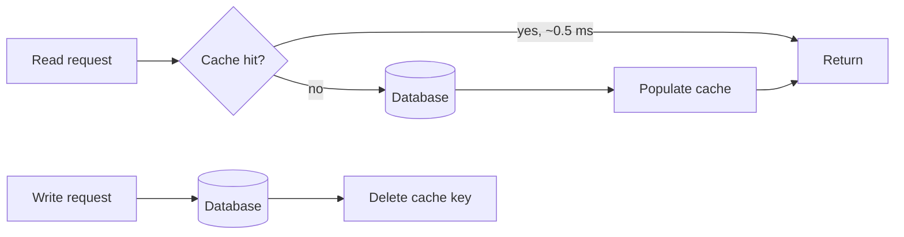

The same expensive answer is being recomputed for every request. A cache keeps the hot result in memory, close to the caller, so most reads never reach the database.

# 01 · Slow reads → add a cache

## What the symptom looks like

- The database is at high read QPS but its data set is small and unchanging.
- p99 read latency is dominated by database time in the traces, not by your services.
- A small number of records or pages accounts for most of the traffic.
- Read QPS grows while write QPS is flat.

## The mechanism

A cache is a key-value store in front of the source of truth. On a read, the application
checks the cache first; a hit returns in well under a millisecond, a miss reads the database and
populates the cache. Correctness depends entirely on how you invalidate.

The default policy is **cache-aside** with a TTL and delete-on-write: the application owns the
logic, the cache holds no truth, and any bug self-heals after the TTL.

## When to reach for it

- Read:write ratio is heavily read-skewed, roughly 10:1 or more.
- The working set fits in memory: a few GB, not a few TB.
- A few seconds of staleness is acceptable to the product — get this number agreed.
- The query is expensive enough that recomputing it is visibly wasteful.

!!! warning "When it is the wrong move"
    Reads are already cheap (an indexed point lookup at 0.2 ms). A network round trip to Redis can be slower.
    The data must be perfectly fresh — a balance, an inventory count at checkout.
    The working set is larger than the cache, so the hit rate would be poor and every request would pay for a miss.
    Every user sees different data and nothing repeats; there is no reuse to exploit.

## Trade-offs

**Staleness becomes a product decision.** Someone must choose the maximum staleness — five seconds or five minutes changes the whole design. Without that number you have a cache you cannot defend.

**Two sources of truth.** Invalidation bugs produce data that is wrong and hard to reproduce. Prefer deleting the key on write over updating it, because delete is idempotent.

**The cache is now on the critical path.** If Redis is down and you have no fallback, you have made the system *less* available. Treat cache failure as a miss, with load shedding behind it.

**Memory is the expensive resource.** You are buying RAM at cloud prices. Budget for the working set and evict aggressively rather than sizing for the data set.

## Failure modes

| Failure | What you see | Fix |
| --- | --- | --- |
| Stampede on expiry | A hot key expires and thousands of requests hit the database at once | Single-flight the recomputation; jitter TTLs |
| Hot key | One Redis shard saturates while others idle | Replicate the key with a random suffix, or cache it in-process |
| Penetration | Requests for non-existent IDs bypass the cache every time | Cache negative results briefly, or put a Bloom filter in front |
| Big keys | One 10 MB value blocks the event loop for everyone | Split into chunks; store a reference to object storage |

## Sizing it

Size the cache to the **working set**, not the data set. If 5% of records serve 95% of
requests, cache that 5%. Watch hit rate as the primary metric: going from 90% to 99% reduces
database load by 10×, and the improvement is entirely in the tail.

## Interview soundbite

> "I would cache the feed cache-aside in Redis with a 30-second TTL and delete-on-write, and single-flight the recomputation so a popular key expiring cannot stampede the database."

## Where to go next

- [Caching theory](../fundamentals/caching.md)
- [Cache building block](../building-blocks/cache.md)
- [LRU implementation](../code/lru-cache.md)
