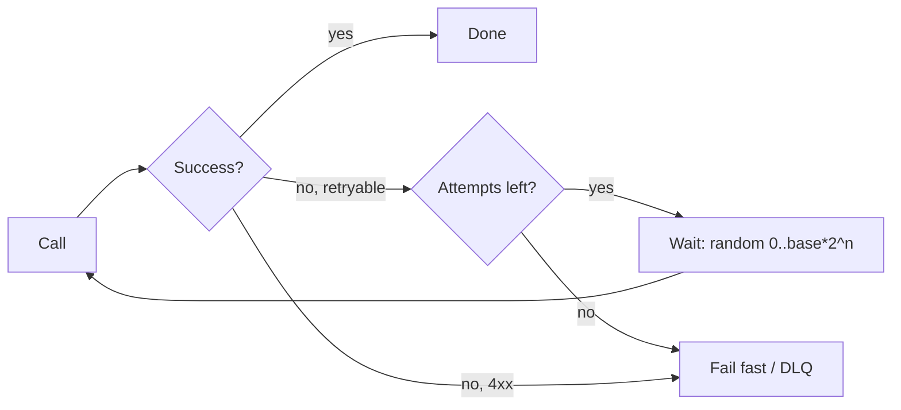

Most errors are blips: a dropped connection, a leader election, a brief overload. Retrying converts them into successes — if the wait is jittered and the operation is safe to repeat.

# 08 · Temporary failures → retry with backoff

## What the symptom looks like

- Error rates are low but non-zero, and the same request succeeds when a user retries manually.
- Failures cluster around deploys, leader elections and network events.
- A dependency reports transient 503s or timeouts rather than consistent errors.

## The mechanism

Retry with exponential backoff and jitter: wait `base × 2^attempt`, randomised across the
full interval, capped at a few attempts and a total time budget. Jitter is what prevents every
client in the fleet from retrying at the same instant and producing a second, self-inflicted
outage.

Retries belong to exactly one layer per call path. Browser plus gateway plus client library
plus service retries multiply into 81 attempts for a single user action.

## When to reach for it

- Failures are transient and the operation is idempotent, or can be made so with a key.
- The caller can afford the extra latency.
- You have a cap on attempts and a retry budget.

!!! warning "When it is the wrong move"
    The error is a 400, 401, 403, 404 or 422 — retrying will never help.
    The operation has a side effect and no idempotency key. Retrying charges the card twice.
    The dependency is clearly down. A circuit breaker, not a retry, is the right response.

## Trade-offs

**Retry storms.** Retries multiply load exactly when the system is least able to take it. Three retries per request triples traffic during an incident.

**Latency tail.** A retried request is slower than the timeout you configured; the user may wait several seconds.

**Masked fragility.** A system that always retries hides a dependency that is 5% broken. Track retry rate as a metric.

**Duplicate side effects.** The most expensive bug in this list, and entirely avoidable with an idempotency key.

## Failure modes

| Failure | What you see | Fix |
| --- | --- | --- |
| Synchronised retries | Every client retries at the same millisecond | Full jitter: `random(0, min(cap, base*2^n))` |
| Unbounded retries | A poison request loops forever | Cap attempts; move to a DLQ after N failures |
| Ignoring Retry-After | You hammer a service that told you to wait | Honour the header; it is the dependency setting your rate |
| Retries on non-idempotent writes | Duplicate charges, duplicate emails | Idempotency key, or do not retry |

## Sizing it

Three to five attempts with a total budget of a few seconds. If the p99 of the dependency
is 300 ms, a 2-second timeout with three attempts covers almost every transient case without
holding a thread for long enough to matter.

## Interview soundbite

> "Exponential backoff with full jitter, capped at three attempts and a five-second budget, and only on idempotent calls — the write path carries an idempotency key so a retry after a timeout cannot double-charge."

## Where to go next

- [Retry and backoff](../building-blocks/retry.md)
- [Retry implementation](../code/retry.md)
- [Idempotency](../building-blocks/idempotency.md)
