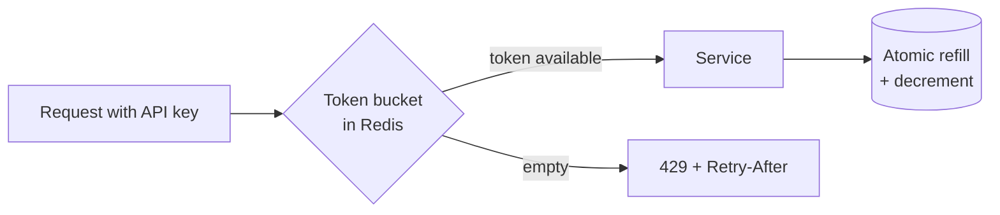

One caller can consume capacity that everyone else needs. A rate limiter decides how much traffic each identity may send, and rejects the excess cheaply and predictably.

# 09 · Too many requests → rate limiting

## What the symptom looks like

- One API key, IP or tenant accounts for a disproportionate share of traffic.
- A scraper or a runaway client job degrades the service for everyone.
- You sell tiered quotas and need to enforce them.
- The system is being protected by timeouts instead of by a decision.

## The mechanism

A token bucket per identity: tokens refill at a fixed rate, each request consumes one,
and an empty bucket means 429. Capacity sets the allowed burst; refill rate sets the sustained
rate. Those two knobs are independent, which is why it is the right default.

Distributed enforcement is the hard part. Either centralise the counters in Redis with an
atomic update, or give each instance a slice of the global budget and accept approximation.

## When to reach for it

- A small number of callers can monopolise capacity.
- You need per-tenant fairness or paid quotas.
- Expensive endpoints need tighter limits than cheap ones.

!!! warning "When it is the wrong move"
    The traffic is legitimate and you would rather queue it than reject it — use a queue and autoscaling.
    You cannot tolerate a rejected request (internal service calls), where concurrency limits and load shedding are the right tools.

## Trade-offs

**Rejections are a product decision.** A 429 must be documented, with a `Retry-After` and a client that respects it.

**Shared state is a bottleneck.** Redis-based limiting adds a round trip per request and a dependency that can fail.

**Fairness versus utilisation.** Strict per-tenant limits leave capacity idle; work-conserving limits let one tenant take everything.

**The limiter can be the outage.** If Redis is down and you fail closed, your protection mechanism has taken down the API. Fail open for guardrails, closed only for billing.

## Failure modes

| Failure | What you see | Fix |
| --- | --- | --- |
| Fixed-window boundary burst | Double the limit around the window edge | Sliding window counter, or token bucket |
| Counter keys never expire | Memory leak discovered months later | Always set a TTL on counter keys |
| Limiting cheap cached responses | Users throttled on requests that cost nothing | Limit after cache lookup, or exempt cacheable routes |
| Synchronised Retry-After | All rejected clients return at the same instant | Add jitter to the advertised delay |

## Sizing it

Set the sustained limit from measured per-tenant usage at p99, not from a round number.
A burst allowance of 2× the per-second rate covers normal client behaviour; anything larger is
usually hiding a client that should be batching.

## Interview soundbite

> "Token bucket per API key at the gateway — 100 requests a minute sustained with a burst of 200 — counters in Redis updated atomically, and tighter buckets on the expensive search endpoint with a jittered Retry-After."

## Where to go next

- [Rate limiter](../building-blocks/rate-limiter.md)
- [Token bucket code](../code/token-bucket.md)
- [Design a rate limiter](../case-studies/rate-limiter-service.md)
