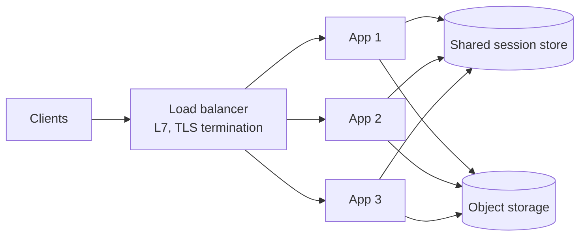

One machine has a ceiling. A load balancer spreads requests across many, health-checks them, and lets capacity change without clients noticing.

# 03 · Too much traffic → add a load balancer

## What the symptom looks like

- A single instance is at high CPU or near its connection limit.
- You cannot deploy without downtime.
- Response time degrades in a step pattern as concurrency rises.
- You need the app tier to survive losing an instance.

## The mechanism

The load balancer accepts connections on a stable address and forwards them to one of
several backends, chosen by an algorithm (round robin, least connections, consistent hash). It
removes backends that fail their health check and returns them when they recover.

The prerequisite is **statelessness**. If a session lives in one instance's memory, spreading
requests breaks the user's experience. So the real work is moving sessions to a shared store,
uploads to object storage, and any in-process cache from authoritative to advisory.

## When to reach for it

- More than one instance serves traffic, or will need to.
- You want zero-downtime deploys: drain, replace, resume.
- You want TLS terminated once at the edge rather than in every service.

!!! warning "When it is the wrong move"
    The bottleneck is a single database that cannot be replicated or sharded — balancing the app tier will not help.
    You have only one instance and no redundancy requirement. Add a second instance first; the balancer is then a detail.

## Trade-offs

**It is a single point of failure unless redundant.** Active-passive or active-active pairs, plus DNS or anycast in front, or you have moved the SPOF up a layer.

**Sticky sessions are a trap.** They make scaling uneven, break on deploy, and hide state that should be shared. Use only for protocols that cannot carry a token.

**The balancer sees every request.** Heavy per-request L7 work makes it the bottleneck and the single thing whose outage takes everything down.

**Health checks are a design decision.** Too shallow and you route to broken instances; too deep and one dependency blip removes the whole fleet.

## Failure modes

| Failure | What you see | Fix |
| --- | --- | --- |
| Fleet-wide removal | One slow dependency marks every instance unhealthy and all traffic is refused | Check only local readiness; treat dependency health separately |
| Cold start routing | New instances receive traffic before their pools are warm | Readiness probe that verifies the connection pool |
| Dropped requests on deploy | Random 502s during rollouts | Connection draining with a grace period |
| Uneven load | Long-lived WebSocket connections pin to a few backends | Least-connections plus periodic rebalancing |

## Sizing it

A single modern instance handles a few thousand requests per second for a simple JSON
endpoint. The number that matters is not the balancer's capacity but the **per-instance
capacity × instance count**, and whether the shared tier behind it (database, cache) can absorb
the total.

## Interview soundbite

> "Stateless app servers behind an L7 balancer with least-connections and readiness checks that verify the database pool, plus connection draining on deploy."

## Where to go next

- [Load balancer](../building-blocks/load-balancer.md)
- [Scalability](../fundamentals/scalability.md)
- [API gateway](../building-blocks/api-gateway.md)
