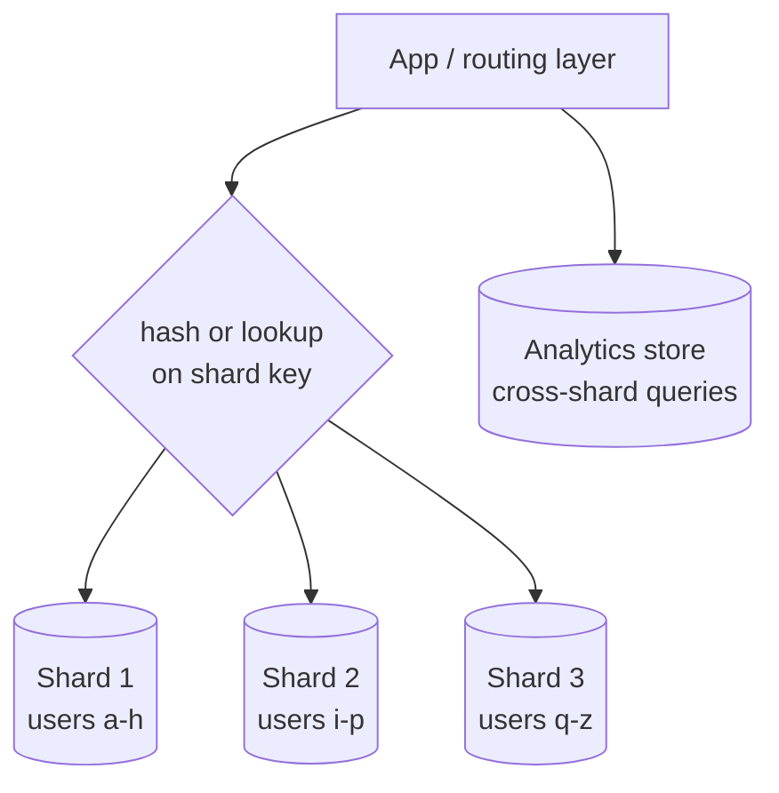

Writes or data exceed what one node can hold. Splitting rows across independent databases by a shard key is the only way past that ceiling — and the most expensive change in this list.

# 05 · Write-heavy database → shard the data

## What the symptom looks like

- Write QPS exceeds what a single primary can absorb after batching and tuning.
- The data set no longer fits on one node, or a replica rebuild takes hours.
- Index maintenance on the write path has become the bottleneck.
- You have already done the cheap things: batching, archiving, index pruning, a bigger machine.

## The mechanism

Rows are partitioned across nodes by a **shard key**. Each shard is an independent
database with its own CPU, disk and failure domain, so write throughput and storage scale with
the number of shards.

The key decides everything. If the dominant query includes the key, it stays on one shard and
the system behaves like a normal database. If it does not, every query becomes a scatter-gather
across N shards.

## When to reach for it

- Writes or storage genuinely exceed one node after tuning, batching and archiving.
- The access pattern is dominated by one key — tenant, user, conversation — so queries stay single-shard.
- Growth is predictable enough to plan logical shards mapped to physical nodes.

!!! warning "When it is the wrong move"
    The bottleneck is reads. Replicate and cache instead; sharding will not help.
    Your queries are inherently cross-entity (reporting, analytics) — move those to a different store first.
    You have not indexed, batched or archived. Sharding a badly tuned database gives you N badly tuned databases.

## Trade-offs

**Cross-shard queries.** Joins and aggregates become application code or fan-out. `COUNT(*)` over all users is now N queries.

**Cross-shard transactions.** Atomicity across shards becomes a saga, or is avoided by choosing a key that keeps related rows together.

**The shard key is nearly irreversible.** Re-keying means migrating every row with downtime risk. Choose by the dominant query, distribution and stability.

**Hot shards.** One celebrity or enterprise tenant melts one node while others idle. Needs key salting, a dedicated shard, or a cache.

**Operational multiplication.** N times the backups, migrations, monitoring and failure modes, plus a rebalancing process that must not disturb production.

## Failure modes

| Failure | What you see | Fix |
| --- | --- | --- |
| Hot shard | One node at 100% while others are at 20% | Salt the key, dedicate a shard, or cache that tenant |
| Scatter-gather query in a hot path | A dashboard query fans out to 1,024 shards | Move aggregates to an OLAP store; precompute |
| Uneven byte distribution | Even key counts but one shard fills first | Monitor bytes per shard; rebalance logical shards |
| Split-brain during resharding | Writes accepted on both sides of a move | Fence the source shard before cutover |

## Sizing it

Use many more **logical** shards than physical nodes — 1,024 logical shards on 16 nodes —
mapped in a small lookup table. Growing the cluster becomes a metadata change plus background
data movement, instead of a re-key of every row. Plan each shard to be at most 70% full so
compaction and replica rebuilds have room.

## Interview soundbite

> "I would shard by tenant_id because every query is tenant-scoped, so it stays single-shard. 1,024 logical shards across 16 physical nodes mapped in a table, so growing the cluster is a metadata change rather than a migration."

## Where to go next

- [Sharding](../building-blocks/sharding.md)
- [Replication and partitioning](../fundamentals/replication-and-partitioning.md)
- [Shard router code](../code/sharding.md)
