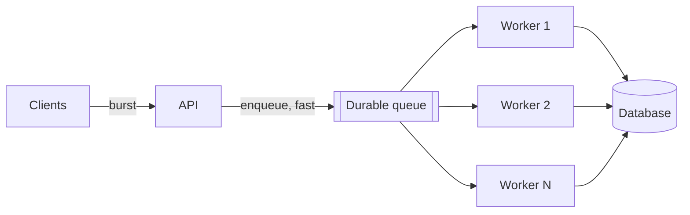

Arrival rate exceeds processing rate for short bursts. A queue absorbs the burst, decouples the two rates, and lets the caller return immediately.

# 02 · Write spikes → buffer with a queue

## What the symptom looks like

- Traffic is bursty — a sale, a batch import, a scheduled job, an upload storm.
- Write latency spikes while the database is not actually saturated on average.
- Requests time out during bursts but succeed when retried minutes later.
- The work after the write is slow (email, thumbnail, fraud check) and the user does not need it done.

## The mechanism

The producer writes a message to a durable log or queue and returns. Consumers read at
their own pace. The burst is absorbed as queue depth, which drains over minutes rather than
being applied as instantaneous load.

The queue also gives you three things you would otherwise build by hand: durability across
consumer crashes, replay for reprocessing after a bug, and a natural place to fan out to
several consumers.

## When to reach for it

- The producer does not need the result to respond — or can respond with a pending state.
- The downstream work is slower than the ingress, but only in bursts.
- Work must survive a worker crash or a deploy.
- Several consumers need the same event (fulfilment, analytics, notifications).

!!! warning "When it is the wrong move"
    The caller needs the result synchronously — a read, an authorisation check, a payment authorisation.
    Traffic is steady and the database is genuinely saturated; a queue just moves the backlog.
    The work is trivially fast. Adding a queue adds latency, duplicates and a component for no gain.

## Trade-offs

**Completion becomes asynchronous.** The API must return a pending state and the system must reconcile later. This is a product change, not just a technical one.

**At-least-once delivery.** Duplicates are guaranteed at some point, so every consumer must be idempotent. See [delivery semantics](../fundamentals/delivery-semantics.md).

**Ordering is per key, not global.** Global ordering means one partition and one consumer, which caps throughput. Choose the partition key from what needs ordering.

**A queue hides backpressure.** A growing queue looks healthy until it is a two-hour delay. Alert on the age of the oldest message, not depth.

**Another system to operate.** Partitions, retention, rebalances, consumer groups. Managed services reduce the burden but not the concepts.

## Failure modes

| Failure | What you see | Fix |
| --- | --- | --- |
| Poison message | One message fails forever and blocks its partition | Retry limit, then dead-letter queue |
| Consumer lag | Delay grows silently until users notice | Alert on oldest message age; autoscale consumers on lag |
| Retry storm | A failing dependency causes unbounded retries | Backoff with jitter, and a circuit breaker around the handler |
| Rebalance storm | Consumers constantly rejoin; processing stalls | Tune session timeouts and max poll interval |

## Sizing it

Partition count is a capacity decision: a topic with 12 partitions feeds at most 12
consumers in a group. Size for peak consumer count plus headroom, and remember that partition
count is hard to increase later without breaking key ordering guarantees.

## Interview soundbite

> "Writes become enqueue-then-ack, the consumer is idempotent on the event ID, and I alert on the age of the oldest unprocessed message rather than queue depth."

## Where to go next

- [Message queue](../building-blocks/message-queue.md)
- [Delivery semantics](../fundamentals/delivery-semantics.md)
- [Notification case study](../case-studies/notifications.md)
